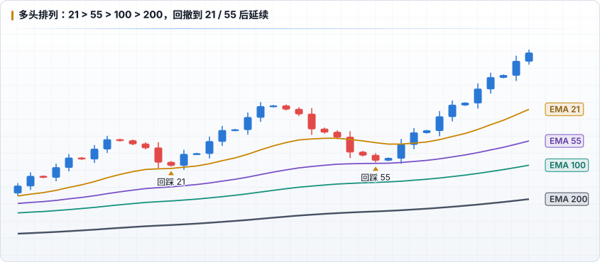
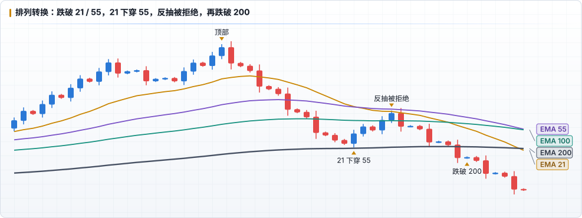

# EMA 用法与 ICT 结合

## 1. 排列（Stack）

| 排列 | 定义 | 含义 |
|---|---|---|
| **多头排列** | 价格 > 21 > 55 > 100 > 200，且均线向上 | 各级别趋势一致向上，只考虑做多 |
| **空头排列** | 价格 < 21 < 55 < 100 < 200，且均线向下 | 各级别趋势一致向下，只考虑做空 |
| **缠绕** | 均线交错、走平、间距很小 | 震荡 / 转换期，均线信号失效 |

均线之间的 **间距** 也有信息：间距扩大 = 趋势加速，间距收窄 = 趋势减速，可能进入整理。

## 2. 回踩

多头排列中，回撤的深度反映趋势强度：

| 回撤到 | 解读 |
|---|---|
| 21 EMA | 强趋势的浅回撤，常见于位移之后 |
| 55 EMA | 正常回撤 |
| 100 / 200 EMA | 深回撤，趋势可能在转换，需要结构确认 |

回踩均线 **本身不是入场信号**，要看回踩时是否同时出现结构（MSS / CISD）和 PD Array。

## 3. 交叉与排列转换

- **21 上穿 55**（金叉）/ **21 下穿 55**（死叉）：中期方向转换的确认，但滞后明显，通常发生在价格已经走出一段之后
- **价格站上 / 跌破 200 EMA**：长期方向的分界，跌破后反抽 200 被拒绝，是转换更可靠的证据
- 典型的转换顺序：跌破 21 → 跌破 55 → 21 下穿 55 → 反抽 21 / 55 被拒绝 → 跌破 100 / 200

## 与 ICT 结合

EMA 不替代 ICT 的核心条件（时间、流动性、PD Array），它补充的是 **「大趋势方向」和「回撤位置」** 的客观参考。

| 场景 | 组合方式 |
|---|---|
| **HTF Bias 过滤** | HTF（4H / 日线）价格在 200 EMA 上方且多头排列 → Bias 偏多，与 [HTF Bias](../ict/05-htf-bias.md) 的结构判断互相印证；两者矛盾时降低仓位或只做 A+ |
| **PD Array 汇合** | 回撤到折价区的 FVG / OB 同时落在 21 或 55 EMA 附近，汇合度更高 |
| **扫流动性** | 价格刺穿 55 / 100 EMA 扫掉下方 SSL 后迅速收回，配合 MSS，是 Manipulation 的辅助证据 |
| **目标** | 逆势扫完流动性后，反方向的第一个 EMA（如 21 或 55）常是第一目标 |

## 不该做的

- 只因为「回踩到 21 EMA」就入场，没有结构和 PD Array
- 在均线缠绕的震荡区交易金叉 / 死叉
- 用 LTF 的 200 EMA 推翻 HTF 的 Bias

## 记录方式

- 辅助确认时保持 `strategy: ICT`，在 `tags` 中标记，如 `tags: [ema-55-pullback]`、`tags: [above-ema200]`
- 复盘时写清楚是哪个周期的 EMA
