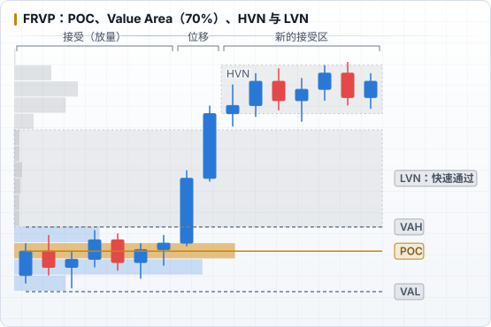

# FRVP 核心概念

## 基本元素

| 名称 | 定义 | 含义 |
|---|---|---|
| **POC**（Point of Control） | 区间内成交量最大的价格 | 区间内最「公平」的价格，多空最认可的位置 |
| **Value Area（VA）** | 以 POC 为中心向两边扩展，直到包含 **70%** 成交量的价格范围 | 市场接受的价值区 |
| **VAH / VAL** | Value Area High / Low，价值区的上下边界 | 价值区的边缘，常见的反应位 |
| **HVN**（High Volume Node） | 分布上的成交密集峰 | 价格容易停留、震荡，起支撑 / 阻力作用 |
| **LVN**（Low Volume Node） | 分布上的成交稀少谷 | 价格快速穿过的区域，回到这里常被拒绝或再次快速穿过 |

- 70% 来自 Market Profile（J. Peter Steidlmayer）传统，约等于正态分布 ±1σ，多数平台可以在设置里修改
- **Naked POC**（裸 POC）：之前区间的 POC 之后从未被价格回测过，常被当作潜在目标

## 设置

- **Row Size / Rows**：价格分几行统计。行数太少看不出 LVN，太多则噪音大；NQ 日内可以从每行 5–10 点开始试，保持固定
- **Up / Down Volume**：区分主动买卖（基于 K 线涨跌估算，不是真实 order flow）
- 底层数据是 K 线成交量，周期越小统计越精细；TradingView 会根据区间长度自动选择数据周期

## 分布形态

| 形态 | 特征 | 常见解读 |
|---|---|---|
| **D 形**（正态） | POC 居中，两边对称 | 平衡、震荡，等待突破 |
| **P 形** | 成交集中在上部，下方细长 | 下方是快速上涨的腿，上方被接受；常见于空头回补或上涨后的平衡 |
| **b 形** | 成交集中在下部，上方细长 | 上方是快速下跌的腿，下方被接受；常见于多头平仓或下跌后的平衡 |
| **双分布（B 形）** | 两个 HVN，中间一个 LVN | 两个价值区，中间 LVN 是分界线 |
| **细长形** | 没有明显的 POC 聚集 | 单边趋势，价格一路被拒绝 |

## 与 ICT 概念的对应

这只是直觉上的对照，不是严格等价：

| Volume Profile | ICT |
|---|---|
| LVN | 位移腿、FVG、Liquidity Void —— 价格快速通过、留下低效 |
| HVN / POC | 盘整区、Equilibrium —— 价格充分交易过的「公允」区域 |
| VAH / VAL 之外 | 区间外流动性（ERL）附近 |
