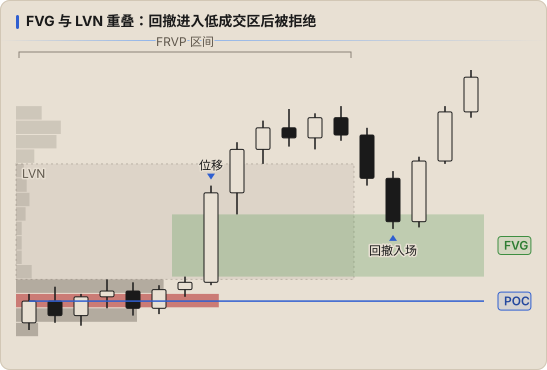

# FRVP 用法与 ICT 结合

## 区间怎么选

FRVP 的结论完全取决于区间，所以选区间要有 **规则**，不能看图凑：

| 区间 | 用途 |
|---|---|
| **一条位移腿**（从摆动低点到摆动高点） | 看这段上涨 / 下跌的成本分布，找回撤入场位（LVN、POC） |
| **一个交易区间（dealing range）** | 与 [Premium / Discount](../ict/03-pd-arrays.md) 同一个区间，看价值区偏向哪一侧 |
| **前一日 / 前一时段**（如 Asia、London） | 得到前一时段的 POC、VAH、VAL，作为当前时段的参考位 |
| **一段盘整** | 判断盘整的价值区，突破后回踩 VAH / VAL |

原则：起点和终点都应是 **结构上有意义的点**（摆动高低点、时段开始结束），并在复盘截图里保留同一个区间。

## 常见用法

### 1. 回撤到 LVN

位移腿中的 LVN 是快速通过的区域。价格回撤到 LVN 时，常见两种结果：被拒绝（顺势入场机会），或者再次快速穿过去往下一个 HVN。

### 2. 价值区边缘

- 价格回到价值区内（从 VAL 下方收回）→ 倾向于穿过整个价值区到对侧（「80% 规则」的思路，需自己用数据验证）
- 价格在 VAH / VAL 被拒绝 → 留在区间外，可能开始新的价值区

### 3. POC 作为目标

- 前一时段 / 前一日的 POC（特别是 Naked POC）常作为回归目标
- 逆势扫完流动性后，第一目标可以看最近的 POC

## 与 ICT 结合

| 场景 | 组合方式 |
|---|---|
| **FVG + LVN** | 位移腿里的 FVG 同时是 FRVP 上的 LVN → 双重的「低效」证据，入场位质量更高 |
| **OB + HVN** | OB 所在价格是 HVN，说明该位置有真实的成交承接 |
| **Premium / Discount** | 对 dealing range 画 FRVP：Bias 看涨时，若 POC 位于折价区，说明成交主要发生在低位，折价区的支撑更可靠 |
| **DOL** | 对侧的 HVN / Naked POC 与 PDH / PDL 等流动性接近时，目标可信度更高 |
| **扫流动性后** | 扫掉前低后迅速收回价值区（VAL 上方），配合 MSS，是 Manipulation 的辅助证据 |

## 不该做的

- 每次重新拖动区间，直到 profile 「看起来」支持自己的方向
- 在成交量数据不可靠的品种上（外汇现货的 tick volume）过度依赖细节
- 把 HVN / LVN 当作入场信号本身，忽略时间和流动性条件

## 记录方式

- 辅助确认时保持 `strategy: ICT`，在 `tags` 中标记，如 `tags: [frvp-lvn]`、`tags: [frvp-poc-target]`
- 截图保留 FRVP 区间，复盘时写明区间起止点
