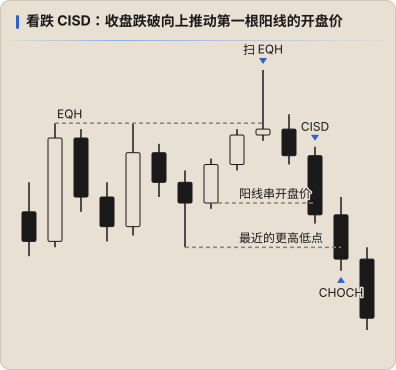
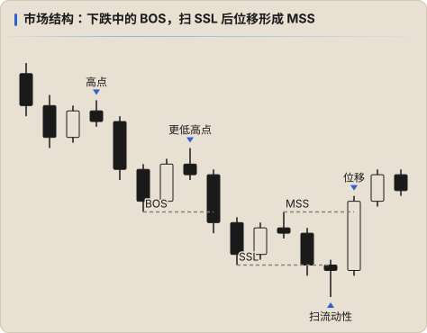

# 市场结构

## 摆动点（Swing High / Low）

- **Swing High**：一根 K 线的高点高于左右两侧相邻 K 线的高点（三根 K 线结构）。
- **Swing Low**：一根 K 线的低点低于左右两侧相邻 K 线的低点。
- 按重要性分为：
  - **STH / STL**（短期高低点）：普通摆动点
  - **ITH / ITL**（中期高低点）：两侧都有更低 / 更高的短期点
  - **LTH / LTL**（长期高低点）：两侧都有更低 / 更高的中期点

结构判断时，**中期高低点** 通常比短期高低点更有参考价值。

### 摆动点有没有效（高效 / 低效）

先分清两个「低效」：

| | ICT 的「低效区」 | Keyshot 说的「低效的阻力区」 |
|---|---|---|
| 指什么 | 单边快速移动留下的失衡区，如 FVG（见 [流动性](./02-liquidity.md)） | 摆动点 **作为支撑 / 阻力不牢靠** |
| 怎么形成 | 位移太快，只有一方在成交 | 价格慢慢磨上去（或磨下来），沿途留下一串摆动点 |
| 价格怎么对待它 | 回来回补 | 逐个击穿，每击穿一个都给对手方添燃料 |

Keyshot 的说法（[导师规则](../mentors/keyshotvv/01-rules.md)）：

- 积累后转空时，之前涨上来留下的每个摆动点都是低效的阻力区，下面有大量多头燃料，所以会跌得特别顺；传统的支撑阻力会被逐个击破（[原帖](https://x.com/Keyshotvv/status/2112560339304989159)）
- 想做多只认日线的低点，小级别信号全部屏蔽（[原帖](https://x.com/Keyshotvv/status/2111116850658673055)）
- 「再次跌破」才是完整结构，第一次跌破只是单个波段的清扫（[原帖](https://x.com/Keyshotvv/status/2099393342840926521)）

他没有公开过完整的判定标准，下面是整理的判断方法（不是他的规则）：

| 看什么 | 低效：容易被击穿，是燃料 | 有效：能挡住价格 |
|---|---|---|
| 怎么形成 | 通道或阶梯式慢涨 / 慢跌里，K 线重叠多、回调浅，一串差不多的摆动点 | 先扫一侧流动性，再位移离开（通常留下 FVG），是一段行情的起点 |
| 周期 | 比交易周期小的 STH / STL | 交易周期或更大周期的 ITH / ITL、LTH / LTL，如日线低点 |
| 与大级别方向 | 逆大级别形成，如日线下跌中 1H 反弹留下的低点 | 顺大级别形成 |
| 止损还在不在 | 没被扫过，止损还堆着 → 是价格要去拿的目标 | 已被扫过一次并出现强烈反应，止损已清掉 |

用法：低效的摆动点当作 **目标**（DOL 沿途一个个拿掉）；有效的摆动点才拿来作为 **进场和止损的参考**。

> 例：[2026-10-28 BTC 做空](../../journal/trades/2026/2026-10-28-btc-01.md)。日线下跌，1H 上涨扫等高点；这段 1H 上涨留下的低点（如 80413）都属于低效的，是空单沿途的目标；能挡住价格的支撑要去日线级别找。

## BOS、CHOCH、MSS 与 CISD

| 概念 | 定义 | 含义 |
|---|---|---|
| **BOS**（Break of Structure） | 顺势突破前一个摆动点 | 趋势延续 |
| **CHOCH**（Change of Character） | 逆势第一次破坏结构 | 趋势可能转变 |
| **MSS**（Market Structure Shift） | 逆势突破最近的短期摆动点，**且伴随位移（displacement）** | 短期方向可能转变；ICT 的说法，与 CHOCH 接近但更强调位移 |

### CHOCH 的两个方向

| 原来的趋势 | CHOCH 是什么 | 意味着 |
|---|---|---|
| 上涨（高点、低点不断抬高） | 跌破**最近一个更高的低点** | 看跌 CHOCH，上涨可能结束 |
| 下跌（高点、低点不断降低） | 突破**最近一个更低的高点** | 看涨 CHOCH，下跌可能结束 |

CHOCH 只看 **你观察的那个周期** 上的趋势：日线在跌时，1H 可能正处在一段小上涨里。顺日线做空时，等的就是这段 1H 小上涨被破坏（看跌 CHOCH）。

> 例：[2026-10-28 BTC 做空](../../journal/trades/2026/2026-10-28-btc-01.md)。日线下跌，1H 从 79468 涨到 81271 扫掉等高点；这段 1H 上涨里最近的更高低点是 80413，跌破它才算看跌 CHOCH。

### CISD（Change in State of Delivery）

价格投递方向的转变。一段行情由一串同向收盘的 K 线推出来，当价格 **收盘越过这串 K 线第一根的开盘价**，原来的推动就被否定了。

| 原来的推动 | 看什么价位 | CISD 成立 |
|---|---|---|
| 一串阳线把价格推上去（通常扫了上方流动性） | 这串阳线 **第一根的开盘价** | K 线 **收盘跌破** 它 → 看跌 CISD |
| 一串阴线把价格推下来（通常扫了下方流动性） | 这串阴线 **第一根的开盘价** | K 线 **收盘站上** 它 → 看涨 CISD |

| | 需要突破什么 | 速度 | 代价 |
|---|---|---|---|
| MSS / CHOCH | 结构摆动点（最近的更高低点 / 更低高点） | 慢，确认度高 | 入场离极值远，止损大 |
| CISD | 推动 K 线串的开盘价（只看实体收盘） | 快，通常早于 MSS | 假信号更多，必须配合关键位置和流动性清扫 |

- Keyshot 的理解：**本级别 CISD = 次级别 MSS**。1H 的 CISD 放到 5m / 1m 上通常就是一个 MSS，所以不切换周期也能提前看到结构转变（见 [导师规则](../mentors/keyshotvv/01-rules.md)）。
- **怎么数推动 K 线串** 会影响 CISD 价位：严格按「连续同向收盘」数，一根反向小 K 线就会打断；也有人忽略这种噪音 K 线。选一种数法并保持一致。

> 例：[2026-10-28 BTC 做空](../../journal/trades/2026/2026-10-28-btc-01.md)。05:00 的 1H 阳线（开盘 80751）推高到 81271 扫掉等高点；08:00 收盘 80714 跌破 80751 → 1H 看跌 CISD，比跌破 80413 的 CHOCH 早。若忽略 04:00 的小阴线、从 02:00 开盘 80469 算起，入场时则尚未触发。

一个高质量的 MSS 通常满足：

1. 先扫掉一侧流动性（例如跌破 Asia Low）
2. 然后出现 **位移**：连续、实体饱满的 K 线快速反向，留下 FVG
3. 位移收盘突破最近的短期摆动点

> 没有扫流动性、没有位移的「突破」，更可能是噪音或诱导（inducement）。

## 位移（Displacement）

- 强势、单方向、实体大、影线短的一根或一组 K 线
- 是「聪明钱真正入场」的证据，**几乎总会留下 FVG**
- 位移的起点常成为 Order Block，位移中留下的 FVG 是回撤入场点

## 内部 / 外部区间流动性

- **ERL**（External Range Liquidity）：区间外的高点 / 低点 —— 止损单聚集处
- **IRL**（Internal Range Liquidity）：区间内的 FVG 等低效区
- 价格大体在两者之间交替：**从 ERL 到 IRL，从 IRL 到 ERL**。
  - 刚扫完外部高点 → 下一个目标往往是区间内的 FVG
  - 刚回补完 FVG → 下一个目标往往是外部高低点

## 通道的强弱

Keyshot 的态度：**通道就是趋势**，不是「向上的横盘」；不要用流动性逻辑逆着通道做，想参与就等右侧结构（[导师规则](../mentors/keyshotvv/01-rules.md)）。

以多头通道为例：

| 看什么 | 强 | 弱 |
|---|---|---|
| 推进方式 | 连续突破 → 窄通道 | 弱通道；每波越来越弱、波动率越来越低（[原帖](https://x.com/Keyshotvv/status/2025589464198942942)） |
| 突破前高后的回调 | 影线都不碰前高最强，实体不碰前高次强（[原帖](https://x.com/Keyshotvv/status/2027280580669509889)） | 回调跌回前高下方 |
| 回调深度 | 有规律，例如每个 1H 波段回调到 50% 再走（[原帖](https://x.com/Keyshotvv/status/2110020207226052940)） | 深回调，接近波段的 75%，是衰竭特征（[原帖](https://x.com/Keyshotvv/status/2055336475064242648)） |
| 大级别 | 1H / 4H 连续强势突破，不能做空（[原帖](https://x.com/Keyshotvv/status/2026699601672339639)） | 出现三推楔形 |

- 弱通道大概率被突破，并回测通道起点（[原帖](https://x.com/Keyshotvv/status/2024634086892196318)）
- 窄的积累代表快，是一种派发；宽的代表慢，是另一种积累（[原帖](https://x.com/Keyshotvv/status/2112576741155946938)）

补充的 PA 判断方法（通用方法，不是他的规则）：阳线多、实体饱满、收在高位附近；回调只有一两根 K 线且不破前一个更高的低点；K 线之间重叠少；每次推进都留下 FVG。阴线变多、回调变长、重叠变多、新高推得越来越短，说明通道在走弱，可能转成区间或反转。

交易上：

1. 先用日线 / 4H 判断通道强弱；**强通道只做顺势**：等回调扫掉通道里的一个摆动低点、出现反应再做多
2. 强多通道里看到等高被扫，**不要直接做空**，那是逆势
3. 通道走弱、出现三推楔形之后才考虑反向，并且等右侧（跌破最近的更高低点，出现 CHOCH）

## 复盘问题

- 入场时，入场周期上是否有清晰的 MSS？`htfBias` 方向与 MSS 方向一致吗？
- 我是不是把普通的回撤当成了结构转变？
- 我拿来做止损 / 进场参考的摆动点是有效的，还是一个低效、迟早被击穿的点？
- 我是不是在逆着一个强通道做？
