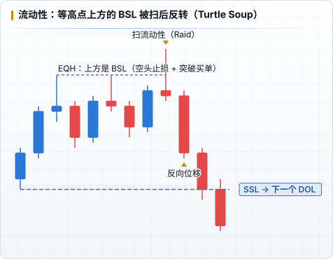

# 流动性

ICT 视角里，价格移动的主要目的是 **获取流动性**（止损单、突破挂单）并 **回补低效区**。

## 流动性在哪里

| 类型 | 位置 | 例子 |
|---|---|---|
| **BSL**（Buy-side Liquidity） | 高点上方：空头止损 + 突破买单 | 前高、PDH、PWH、Asia High、EQH |
| **SSL**（Sell-side Liquidity） | 低点下方：多头止损 + 突破卖单 | 前低、PDL、PWL、Asia Low、EQL |

重点关注：

- **相对等高 / 等低（EQH / EQL）**：散户眼中的「双顶双底」，止损最密集，是最明显的目标
- **前日 / 前周高低点**：PDH / PDL、PWH / PWL
- **时段高低点**：Asia High/Low、London High/Low、NY 开盘区间
- **未被触及的旧高低点**：越老、越显眼，吸引力越强

## Raid（扫） vs Run（走）

- **Liquidity Raid / Sweep**：价格刺穿高低点拿走止损后迅速反转 → 反转信号（Turtle Soup、Judas Swing 的基础）
- **Liquidity Run**：价格突破后持续前进 → 这只是走向更远 DOL 的途中

区分方法：看突破后是否出现 **反向位移 + MSS**。

## Draw on Liquidity（DOL）

DOL = 价格接下来最可能去的流动性目标，是建立 bias 的核心问题：

1. 价格刚从哪里来？（刚扫了哪一侧？刚回补了哪个 FVG？）
2. 价格要去哪里？最近、最明显、还没被拿掉的流动性在哪一侧？
3. 两者结合：刚扫完 SSL + 出现看涨位移 → DOL 大概率是上方 BSL

在日志里：`liquiditySweep` 记录 **入场前被扫的流动性**，`drawOnLiquidity` 记录 **目标流动性**。

## Inducement（诱导）

在真正的目标流动性之前，市场常常先制造一个小的、看起来「可以入场」的结构，诱使交易者过早进场，然后扫掉他们的止损。应对：等待 **扫掉明显流动性之后** 再找入场。

## 复盘问题

- 我入场前，价格有没有先扫一侧流动性？还是我在流动性被拿之前就进场了？
- 我的目标是清晰的流动性池，还是随意的整数 R？
