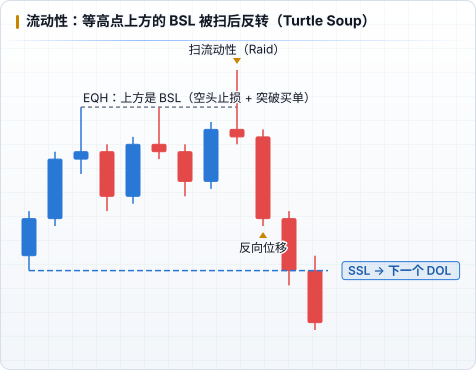

# 流动性

ICT 视角里，价格移动的主要目的是 **获取流动性**（止损单、突破挂单）并 **回补低效区**。

## 流动性在哪里

| 类型 | 位置 | 例子 |
|---|---|---|
| **BSL**（Buy-side Liquidity） | 高点上方：空头止损 + 突破买单 | 前高、PDH、PWH、Asia High、EQH |
| **SSL**（Sell-side Liquidity） | 低点下方：多头止损 + 突破卖单 | 前低、PDL、PWL、Asia Low、EQL |

重点关注：

- **相对等高 / 等低（EQH / EQL）**：散户眼中的「双顶双底」，止损最密集，是最明显的目标
- **前日 / 前周高低点**：PDH / PDL、PWH / PWL
- **时段高低点**：Asia High/Low、London High/Low、NY 开盘区间
- **未被触及的旧高低点**：越老、越显眼，吸引力越强

[教程](https://chanlunpp.org/basics-ict) 1.4 还按级别分了三层：主要流动性（周 / 月 / 季 / 年线的高低点）、中级（15m–1H 的高低点）、次级（1m–5m）。除了上面几类，区间边界、趋势线、整数关口外侧也有止损堆积。**同一价位被碰得越多次而不破，外面的止损越厚，被扫时走得越猛。**

### 多空陷阱（教程 1.5）

止损猎杀的标准过程：价格推向显眼的旧高 / 旧低 → 刺穿 → 散户止损和突破单被触发 → 机构借这些单子成交 → 快速折返，留下长影线。HTF 看跌时向上突破旧高的走势就是 **Bull Trap**，看涨时跌破旧低是 **Bear Trap**。

> 规矩：旧高被突破的那一刻不追多，旧低被跌破的那一刻不追空。

## Raid（扫） vs Run（走）

- **Liquidity Raid / Sweep**：价格刺穿高低点拿走止损后迅速反转 → 反转信号（Turtle Soup、Judas Swing 的基础）
- **Liquidity Run**：价格突破后持续前进 → 这只是走向更远 DOL 的途中

区分方法：看突破后是否出现 **反向位移 + MSS**。

## Draw on Liquidity（DOL）

DOL = 价格接下来最可能去的流动性目标，是建立 bias 的核心问题：

1. 价格刚从哪里来？（刚扫了哪一侧？刚回补了哪个 FVG？）
2. 价格要去哪里？最近、最明显、还没被拿掉的流动性在哪一侧？
3. 两者结合：刚扫完 SSL + 出现看涨位移 → DOL 大概率是上方 BSL

在日志里：`liquiditySweep` 记录 **入场前被扫的流动性**，`drawOnLiquidity` 记录 **目标流动性**。

定下 DOL 之后，目标没到就不要改主意。教程把目标没到就来回换方向（**flip-flop**）列为最典型的错误。

### 低阻力与高阻力（LRLR / HRLR，教程 1.7）

| | LRLR（Low Resistance Liquidity Run） | HRLR（High Resistance Liquidity Run） |
|---|---|---|
| 路径 | 到目标池的路上几乎没有反向的 PD Array | 路上一层层都是反向参考位 |
| 走法 | 快、顺 | 走走停停 |
| 持仓 | 快进快出 | 需要更多时间，止损别太紧 |

怎么看一个高低点是哪种：

- **高阻力的低点**：已经扫过前低、然后被拒绝的低点，这一侧的流动性已经用掉了，价格不容易再跌破它
- **低阻力的高点**：没碰到前高就掉头的高点，上面的止损还在，价格回来时容易穿过去

优先选 LRLR 方向的目标。

## Inducement（诱导）

在真正的目标流动性之前，市场常常先制造一个小的、看起来「可以入场」的结构，诱使交易者过早进场，然后扫掉他们的止损。应对：等待 **扫掉明显流动性之后** 再找入场。

## 挂单入池（教程 7.6）

和「等扫完再进」相反的激进做法：HTF 看涨、价格正走向一个旧低时，提前在旧低或略低处挂多单限价，和机构在同一时刻成交。三个前提缺一不可：流动性池清楚、HTF 方向支持、扫完之后有结构上的依据（反转后能放止损的位置）。少一个就是接飞刀。

## 复盘问题

- 我入场前，价格有没有先扫一侧流动性？还是我在流动性被拿之前就进场了？
- 我的目标是清晰的流动性池，还是随意的整数 R？
