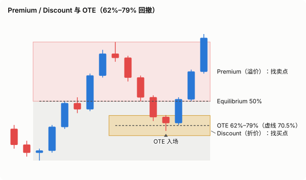
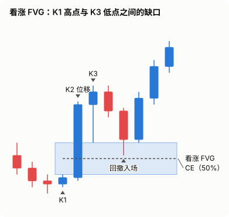
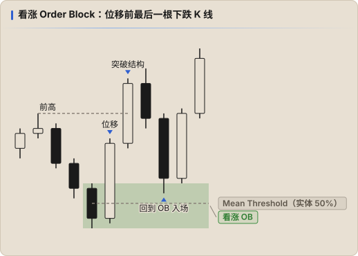
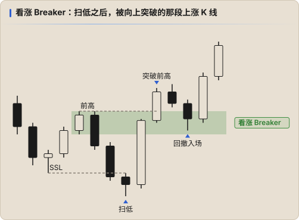

# PD Arrays（溢价 / 折价数组）

PD Array 是价格可能反应的「关键区域」，用于 **找入场点** 和 **找目标**。

## Premium / Discount

- 取一个交易区间（dealing range）：从一个摆动低点到摆动高点
- **50% = Equilibrium（均衡）**
- 上半部分 = **Premium（溢价）**：只考虑卖出
- 下半部分 = **Discount（折价）**：只考虑买入

> 看涨时只在折价区找买点，看跌时只在溢价区找卖点。

### OTE（Optimal Trade Entry）

- 在位移腿的 **62% ~ 79%** 回撤区间入场，**70.5%** 为常用参考
- 与 FVG / OB 重叠时质量更高

## Fair Value Gap（FVG）

三根 K 线结构中，第 1 根和第 3 根的影线没有重叠，中间形成的价格空隙。

- **看涨 FVG**：K1 高点 < K3 低点，空隙为 [K1 高, K3 低]
- **看跌 FVG**：K1 低点 > K3 高点，空隙为 [K3 高, K1 低]
- **CE（Consequent Encroachment）**：FVG 的 50% 位置，常见的精确反应点
- 回撤进入 FVG 是最常见的入场方式；收盘 **穿透整个 FVG** 通常意味着它失效

### 衍生概念

| 名称 | 定义 |
|---|---|
| **IFVG**（Inversion FVG） | FVG 被反向收盘穿过后失效，之后从反方向发挥作用（看涨 FVG 变成阻力） |
| **BPR**（Balanced Price Range） | 一个看涨 FVG 与一个看跌 FVG 重叠的区域，往往反应更强 |
| **Volume Imbalance** | 两根 K 线实体之间的缺口（影线有重叠） |
| **Liquidity Void** | 一段只有单边大实体、几乎没有回撤的区域，价格倾向于回来填补 |

## Order Block（OB）

- **看涨 OB**：造成向上位移（并突破结构）之前的 **最后一根下跌 K 线**
- **看跌 OB**：造成向下位移之前的 **最后一根上涨 K 线**
- **Mean Threshold**：OB 实体的 50%，价格不应收盘越过它
- 有效的 OB 必须伴随位移；最好位移中还留下 FVG

## Breaker Block

- 一个 **扫了流动性** 后又被反向突破的 OB
- 例：价格先创新低扫 SSL，然后向上位移突破前高 —— 扫低之前那段上涨的最后一根上涨 K 线区域，变成 **看涨 Breaker**，回撤至此做多
- 与 **Mitigation Block** 的区别：Mitigation 没有扫掉前一个高 / 低点（失败摆动）

## Rejection Block

长影线的高 / 低点区域，价格回到影线实体侧时可能再次被拒绝。

## 质量排序（经验）

同一位置多个 PD Array 叠加 → 反应概率更高：

- FVG + OTE
- Breaker + FVG（= **Unicorn**）
- HTF FVG 内的 LTF 入场

在日志 `pdArrays` 中记录实际使用的数组（可多选），仪表盘会分别统计每种 PD Array 的胜率和期望值。
