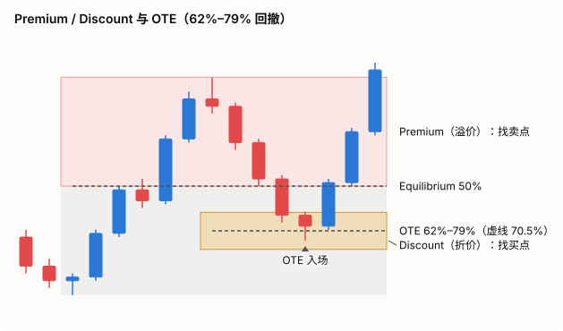
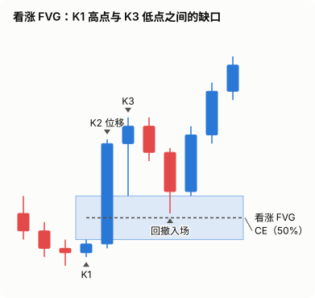
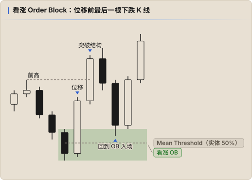
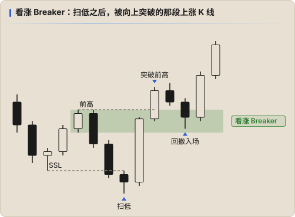

# PD Arrays（溢价 / 折价数组）

PD Array 是价格可能反应的「关键区域」，用于 **找入场点** 和 **找目标**。

## Premium / Discount

- 取一个交易区间（dealing range）：从一个摆动低点到摆动高点
- **50% = Equilibrium（均衡）**
- 上半部分 = **Premium（溢价）**：只考虑卖出
- 下半部分 = **Discount（折价）**：只考虑买入

> 看涨时只在折价区找买点，看跌时只在溢价区找卖点。

[教程](https://chanlunpp.org/basics-ict) 第 4 章的补充：

- **什么区间才能当 dealing range**：上下两个边界都 **已经被扫过** 的区间。两边的流动性都被拿过，高低点才有资格当标尺。每天 / 每个时段开盘后的第一个区间叫 **Opening Range**，它的上下边界先后被扫，就升级成 dealing range。月、日、15m 各框一层，互相嵌套。
- **校准**：50% 线正好穿过这个区间里成交最密集的地方，说明区间框对了。
- **溢价里的溢价**：区间再对半切一次，最上面那 1/4 是最强的做空区，最下面那 1/4 是最强的做多区。
- 进了溢价区只代表 **可以开始找空**，不等于马上会跌。
- 价格在 50% 附近时：看最近一次结构破坏的方向，以及 K 线实体停在 50% 的哪一边。

### OTE（Optimal Trade Entry）

- 在位移腿的 **62% ~ 79%** 回撤区间入场，**70.5%** 为常用参考
- 与 FVG / OB 重叠时质量更高
- 画法：先确认一段带 FVG 的位移，从位移起点的摆动点拉到终点的摆动点（看涨时从低拉到高）
- 0.236、0.382 这种浅回撤不算 OTE。为什么偏深：常见的止损放在 0.618、0.79 外侧，是流动性；离证伪位近，R:R 也更好
- **斐波那契数字本身不是支撑阻力**，真正接住价格的是这个区间里的 FVG、OB 等 PD Array。在 OTE 里找具体的数组挂单

## Fair Value Gap（FVG）

三根 K 线结构中，第 1 根和第 3 根的影线没有重叠，中间形成的价格空隙。

- **看涨 FVG**：K1 高点 < K3 低点，空隙为 [K1 高, K3 低]
- **看跌 FVG**：K1 低点 > K3 高点，空隙为 [K3 高, K1 低]
- **CE（Consequent Encroachment）**：FVG 的 50% 位置，常见的精确反应点
- 回撤进入 FVG 是最常见的入场方式；收盘 **穿透整个 FVG** 通常意味着它失效

教程 3.2 的补充：

- 别名：看涨 FVG = **BISI**（Buy-side Imbalance, Sell-side Inefficiency），看跌 FVG = **SIBI**（Sell-side Imbalance, Buy-side Inefficiency）
- K1 和 K3 的影线只要有一点重叠就不算 FVG
- **收盘穿过 CE** 是失效的第一个警告，不用等整个 FVG 被穿透
- FVG 有三个用途：入场区、目标（价格会回来补）、风向标（被穿透说明投递方向变了）
- 三者的关系：位移一定留下 FVG，MSS 一定由位移完成，所以 **合格的 MSS 之后一定有一个新鲜的 FVG 可以等回踩**
- 挂单位置三档：激进挂 FVG 近端边缘，标准挂 CE，保守挂远端。止损放在 FVG 远端外侧或位移起点外侧
- **Immediate Rebalance**：FVG 形成后几根 K 线就立刻被回补（例如冲高后马上回踩前一根的高点）。教程认为这是继续走的燃料，顺原方向跟，不要当成反转

### 衍生概念

| 名称 | 定义 |
|---|---|
| **IFVG**（Inversion FVG） | FVG 被反向收盘穿过后失效，之后从反方向发挥作用（看涨 FVG 变成阻力） |
| **BPR**（Balanced Price Range） | 一个看涨 FVG 与一个看跌 FVG 重叠的区域，往往反应更强 |
| **Volume Imbalance** | 两根 K 线实体之间的缺口（影线有重叠） |
| **Liquidity Void** | 一段只有单边大实体、几乎没有回撤的区域，价格倾向于回来填补 |

教程 3.3–3.7 对这些衍生概念的补充：

- **IFVG**：FVG 被收盘 **整体** 穿过之后，等价格回踩它，朝新方向入场。
- **Liquidity Void（LV）**：相当于多个 FVG 连在一起的放大版，教程认为几乎都会被回补，只是早晚的区别。分工是 **FVG 用来入场，LV 用来看目标和方向**；回补途中上下扫影线不用慌，补完之后看两端外侧的参考位。
- **Volume Imbalance（VI）**：欠的账比 FVG 少，可以被来回穿过；它的上沿、下沿和中点（也叫 CE）是很精确的日内反应位。
- **BPR**：先后被两个方向的位移扫过，买卖两边的账都清了，所以是很硬的支撑 / 阻力，不再需要回补。

### 不回补的缺口（教程 3.7）

看涨为例，一段「上 → 下 → 上」的走势：

| 名称 | 是什么 | 用法 |
|---|---|---|
| **RDRB**（Re-delivered Rebalanced Price Range） | 第二段下跌回补了第一段上涨的失衡，第三段再向上投递 | 识别出这个结构，说明第三段是真方向 |
| **Breakaway Gap（BG）** | 第三段位移留下的 FVG，不会被回补 | 在它的边缘顺势上车，止损放在 BPR 另一侧 |
| **Measuring Gap（MG）** | 趋势中段不被回补的 FVG | 从行情起点量到 MG，再向前等距投影一次，得到终点估计；和 HTF 参考位重合时更可信 |

### 开盘缺口与 Vacuum Block（教程 3.6）

- **NWOG**：保留最近 5 个，在 5m–15m 图上标。CE 是最精确的反应位；向上跳空的缺口倾向做支撑，向下跳空的倾向做阻力；几个缺口叠在一起的价区容易横盘。
- **NDOG**：纽约 17:00 收盘到 18:00 重开之间的缺口。
- **Event Horizon**：两个相邻 NWOG 之间的中线。价格越过中线后，会被较近一侧的缺口吸过去。
- **Vacuum Block**：消息或开盘瞬间造成的日内跳空。三种走法：不补（成为起跑点）；补满后按原方向走（补满的位置就是顺势入场点）；只补一部分（缺口里藏着反向参考位）。纽约上午出现的大多当天补，临近收盘出现的多半留到以后。连涨几周之后再跳空，要提防衰竭缺口（Exhaustion Gap）。

> 加密货币 7×24 交易，没有收盘，NWOG / NDOG 只对股指、外汇等有休市的品种适用。

## Order Block（OB）

- **看涨 OB**：造成向上位移（并突破结构）之前的 **最后一根下跌 K 线**
- **看跌 OB**：造成向下位移之前的 **最后一根上涨 K 线**
- **Mean Threshold**：OB 实体的 50%，价格不应收盘越过它
- 有效的 OB 必须伴随位移；最好位移中还留下 FVG

教程 4.5 的补充：

- **为什么 OB 会有反应**（教程的解释框架）：机构想买的量比市场上的卖单多，就先自己卖出把价格压下去，扫掉下方止损时把真正的多单吃满，然后向上位移。先前那笔卖单此时是亏的，价格回到 OB 时机构平掉它（**Mitigation**），平空就是买盘，这就是反应的来源。
- **有效的 OB 四条**：它的高点（看涨 OB）随后被行情穿过；离开时快、幅度大、留下 FVG（OB + FVG 是高概率组合）；位置关键，常常顺手扫了一个小池；只在一段行情的高低点处找，区间中间的不算。
- **用实体量 MT**，不用影线。理想的回踩影线可以刺进去，但 **收盘不能越过 MT**，越过就失效。
- **挂单三档**：激进挂 OB 高点（看涨 OB 的开盘价），标准挂 MT，保守挂 OB 低点附近。止损统一放在 OB 低点外，目标是对侧最近的流动性池。
- **持仓时的路障检查**：做空期间，每根阳线（看跌 OB 的候选）都应该压得住价格。某根阳线被轻松收复，说明看跌叙事有问题。做多镜像。
- **Propulsion Block**：回踩进旧 OB 里面后反弹的那根 K 线，成为一个新的、更靠前的参考位。它的 MT 绝不能被穿过。
- **Reclaimed OB**：下跌途中提前出现的一串小的看涨反应，可能是机构在分批重建多仓，这些位置以后会被重新启用。

## Breaker Block

- 一个 **扫了流动性** 后又被反向突破的 OB
- 例：价格先创新低扫 SSL，然后向上位移突破前高 —— 扫低之前那段上涨的最后一根上涨 K 线区域，变成 **看涨 Breaker**，回撤至此做多
- 与 **Mitigation Block** 的区别：Mitigation 没有扫掉前一个高 / 低点（失败摆动）

教程 4.6–4.7 的补充：

- **Breaker 的顺序**：看涨为 低 → 高 → 更低的低（扫 SSL）→ 更高的高（击穿看跌 OB）；看跌为 高 → 低 → 更高的高 → 更低的低。扫完低点后必须 **立刻** 反弹。
- **OB 和 Breaker 的关系**：OB 是没被击穿的建仓痕迹，Breaker 是已经被击穿、换了手的痕迹，同一个价区可以先后扮演两种角色。教程认为 Breaker 的确定性通常高于 OB。
- 击穿如果发生在顺势方向，Breaker 是趋势延续的加油站，不是反转信号。
- **Breaker 用实体量**，消息日的长影线会把边界弄脏。
- **投影目标**：取扫完流动性之后那段离开的走势（不是扫止损那一段）当 A→B，用斐波那契往前投影，**1 倍标准差** 是基础目标；HTF 有更远的池子时可以看 2–4 倍。
- 最好的 Breaker 同时吃掉近端（短期摆动点外侧）和远端（HTF 池）两层流动性。

| | Breaker Block | Mitigation Block |
|---|---|---|
| 反转前 | 扫了流动性（更高的高 / 更低的低） | 失败摆动（更低的高 / 更高的低） |
| 回踩时谁在出手 | 机构回来平掉被击穿的那笔亏损假仓（解套） | 前面追进去被套的人回本出场（教程叫「买家的悔恨」），机构顺势加仓 |
| 怎么量 | 实体 | **整根 K 线含影线** |
| 强度 | 更强 | 次之，因为少了扫流动性这一步，更需要 HTF 方向和时间窗口支持 |

## Rejection Block

长影线的高 / 低点区域，价格回到影线实体侧时可能再次被拒绝。

教程 4.8 的框法（看跌为例）：在一个明显的摆动高点，下界取那里 **最高的开盘价或收盘价**，上界取影线最高点；可以把几根 K 线的影线合起来框。价格再次上探到影线区时做空，卖出挂单放在实体上沿。教程认为它是少数适合直接挂触价单进场的形态。

> 每出现一个新高 / 新低，先预期它会被拒绝；新高之后如果没有向上的位移，被拒绝的概率更大。

## PD Array 矩阵（教程 4.4）

| 溢价侧（做空入场 / 做多目标） | 折价侧（做多入场 / 做空目标） |
|---|---|
| 旧高 | 旧低 |
| 看跌 Rejection Block | 看涨 Rejection Block |
| 看跌 OB | 看涨 OB |
| 看跌 FVG（SIBI） | 看涨 FVG（BISI） |
| 上方 Liquidity Void | 下方 Liquidity Void |
| 看跌 Breaker | 看涨 Breaker |
| 看跌 Mitigation Block | 看涨 Mitigation Block |

- 价格从一个数组走向另一个数组；bias 决定用哪一侧入场
- 周期决定分量：月 / 周是战略，15m 是战术，冲突时听 HTF 的
- **POI**（Point of Interest）是 PD Array 和流动性池的口语统称

## 怎么选数组（教程 4.9）

- 数组之间没有绝对的强弱，**重叠的优先**（OB + FVG 最经典）；重叠时挑 R:R 更好的那条边挂单
- **HTF 选数组，LTF 等确认**，不盲接。教程给的对应：15m 数组配 5m 确认，1H 配 15m，4H 配 1H，日线配 4H
- 两种做法：激进的在数组边缘直接挂限价；稳健的等价格进入数组后，在 LTF 出现位移 + MSS 再进

## 质量排序（经验）

同一位置多个 PD Array 叠加 → 反应概率更高：

- FVG + OTE
- Breaker + FVG（= **Unicorn**）
- HTF FVG 内的 LTF 入场

在日志 `pdArrays` 中记录实际使用的数组（可多选），仪表盘会分别统计每种 PD Array 的胜率和期望值。
