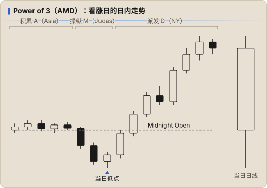

# 时间与时段

ICT 强调「时间比价格更重要」：同样的 setup，在高活跃窗口内出现时质量更高。ICT 的所有时间均为 **纽约时间（America/New_York）**。

## 北京时间对照

| 美国时制 | 纽约 → 北京 | 时段 |
|---|---|---|
| 夏令时 EDT（3 月第二个周日 ~ 11 月第一个周日） | **+12 小时** | NY 09:30 = 北京 21:30 |
| 冬令时 EST | **+13 小时** | NY 09:30 = 北京 22:30 |

> 2026 年美国冬令时从 11 月 1 日开始。日志里的 `time` 建议统一写纽约时间，方便和 ICT 时间窗口对照。

## Killzones（纽约时间）

| 时段 | 纽约时间 | 北京时间（夏令 / 冬令） | 特点 |
|---|---|---|---|
| Asia | 20:00 – 00:00 | 08:00–12:00 / 09:00–13:00 | 形成区间，常作为后续被扫的流动性 |
| London | 02:00 – 05:00 | 14:00–17:00 / 15:00–18:00 | 常形成当日高或低（Judas Swing） |
| NY AM | 07:00 – 10:00 | 19:00–22:00 / 20:00–23:00 | 波动最大，08:30 数据、09:30 股市开盘 |
| London Close | 10:00 – 12:00 | 22:00–00:00 / 23:00–01:00 | 回撤、反转 |
| NY PM | 13:30 – 16:00 | 01:30–04:00 / 02:30–05:00 | 下午延续或反转 |

在日志 `session` 字段使用：`Asia` / `London` / `NY AM` / `NY Lunch` / `NY PM`。

## Silver Bullet 时间窗口

每个窗口 1 小时，在窗口内寻找走向 DOL 的 FVG：

- **03:00 – 04:00**（London）
- **10:00 – 11:00**（NY AM）
- **14:00 – 15:00**（NY PM）

## 关键开盘价

- **Midnight Open（00:00）**：日内参考价。看涨日倾向在其下方形成低点后上涨；看跌日相反
- **08:30**：经济数据发布时间
- **09:30**：股指现货开盘
- **NDOG**（New Day Opening Gap）：期货 17:00 收盘到 18:00 开盘的缺口
- **NWOG**（New Week Opening Gap）：周五收盘到周日开盘的缺口

## Power of 3（AMD）

每根 K 线（日、周、甚至 1 小时）都可以拆成三段：

1. **Accumulation（积累）**：开盘附近窄幅整理（如 Asia 时段）
2. **Manipulation（操纵）**：向反方向的假突破，扫流动性（如 London 的 Judas Swing）
3. **Distribution（派发）**：向真实方向的主要移动（如 NY 时段）

看涨日：开盘 → 先跌破开盘价（形成日内低点）→ 收盘远高于开盘。

## Macros（常见说法）

ICT 提到的算法「宏」时间窗口（每个约 20 分钟），常被引用的有：
08:50–09:10、09:50–10:10、10:50–11:10、13:10–13:40、15:15–15:45。
可作为参考，用日志的 `time` 字段统计你在这些窗口内外的表现差异。

## 不交易的时间

- 高影响数据发布前后几分钟（CPI、NFP、FOMC）——除非你的模型专门针对数据行情
- NY Lunch（12:00–13:30）：流动性差、震荡
- 节假日前后、周五下午
