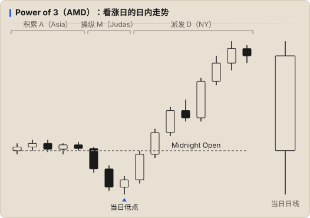

# 时间与时段

ICT 强调「时间比价格更重要」：同样的 setup，在高活跃窗口内出现时质量更高。ICT 的所有时间均为 **纽约时间（America/New_York）**。

## 北京时间对照

| 美国时制 | 纽约 → 北京 | 时段 |
|---|---|---|
| 夏令时 EDT（3 月第二个周日 ~ 11 月第一个周日） | **+12 小时** | NY 09:30 = 北京 21:30 |
| 冬令时 EST | **+13 小时** | NY 09:30 = 北京 22:30 |

> 2026 年美国冬令时从 11 月 1 日开始。日志里的 `time` 建议统一写纽约时间，方便和 ICT 时间窗口对照。

## Killzones（纽约时间）

| 时段 | 纽约时间 | 北京时间（夏令 / 冬令） | 特点 |
|---|---|---|---|
| Asia | 20:00 – 00:00 | 08:00–12:00 / 09:00–13:00 | 形成区间，常作为后续被扫的流动性 |
| London | 02:00 – 05:00 | 14:00–17:00 / 15:00–18:00 | 常形成当日高或低（Judas Swing） |
| NY AM | 07:00 – 10:00 | 19:00–22:00 / 20:00–23:00 | 波动最大，08:30 数据、09:30 股市开盘 |
| London Close | 10:00 – 12:00 | 22:00–00:00 / 23:00–01:00 | 回撤、反转 |
| NY PM | 13:30 – 16:00 | 01:30–04:00 / 02:30–05:00 | 下午延续或反转 |

在日志 `session` 字段使用：`Asia` / `London` / `NY AM` / `NY Lunch` / `NY PM`。

> 节律：看涨日的当日低点多在 London 做出，NY 顺势向上；看跌日相反。**Asia 框定 London，London 框定 NY。**

### 各时段的细节（[教程](https://chanlunpp.org/basics-ict) 5.3–5.5）

下面的点数和 ADR 倍数都是教程给的经验值，没有附回测，用到自己的品种上之前先用日志数据核对。

**Asia Range**（20:00–00:00 的高低，向右延伸到约 11:00）

- London 的第一个目标通常是扫掉 Asia 的一侧
- 区间宽窄预告日型：窄（约 0.2–0.3 倍 ADR，ES 不超过约 15 点）时后面容易扩张；很宽时 London 常常走不出来
- 横盘日的打法：一侧被扫（通常扫出 1–2 倍区间幅度）后回到区间内并出现 MSS，做向另一侧

**London Open**

- 看涨剧本：先扫 Asia 低点 → 进入下方折价的 PD Array → 在那里完成 MSS，当日低点成立，主升段一直走到 NY
- 以下情况不做 London：央行利率决议或重要讲话日、主要节假日、本周目标已经提前达到、Asia 区间太宽

**NY AM**

- 多数日子延续 London 的方向。**除非 NY 开盘时价格正好踩在 HTF PD Array 上**，否则默认延续，不预判反转
- 08:30（数据）和 09:30（现货开盘）是固定的事件点

**London Close（10:00–12:00）**

- 10:00–11:00 附近常出现当日极值后回吐，大波幅日回撤约全天波幅的 20%
- 早盘的持仓在 10:00–11:00 减仓或离场

**午后**

- 12:00–13:30 午餐时段不开新仓
- 13:30–16:00 在趋势日可能走出和上午等距的 1:1 测量目标；15:40、15:50 的收盘市价单（MOC）常带来最后一段加速
- 13:30 的开盘价可以当下午的锚点

## Silver Bullet 时间窗口

每个窗口 1 小时，在窗口内寻找走向 DOL 的 FVG：

- **03:00 – 04:00**（London）
- **10:00 – 11:00**（NY AM）
- **14:00 – 15:00**（NY PM）

> 教程只列了 10:00–11:00 和 14:00–15:00 两个窗口，没有 03:00–04:00。不同版本的说法不一样。

## 关键开盘价

- **Midnight Open（00:00）**：日内参考价。看涨日倾向在其下方形成低点后上涨；看跌日相反
- **08:30**：经济数据发布时间
- **09:30**：股指现货开盘
- **NDOG**（New Day Opening Gap）：期货 17:00 收盘到 18:00 开盘的缺口
- **NWOG**（New Week Opening Gap）：周五收盘到周日开盘的缺口

教程 5.6 补充的锚点：

| 开盘价 | 用途 |
|---|---|
| 05:00、07:00 | NY 时段的折价 / 溢价基准 |
| 13:30 | 下午版的 Midnight Open |
| 周日开盘价 | 周线锚点，见下文「周线 Power of 3」 |

- 组合：看涨时如果 Midnight Open 低于 09:30 开盘价，用 09:30 当更严格的基准；价格同时低于两者就是深度折价
- 开盘价下方的洗盘有两个作用：洗掉多头的止损，同时诱导一批人翻空，他们的止损又成为之后上涨的燃料
- **CPE**（近开盘价入场）：量出开盘价到当日极值的距离，在开盘价另一侧的 1:1 对称位补仓。也可以当金字塔加仓的挂单位，首仓最大、后面递减
- **Opening Range**：09:30–10:30 的首小时区间，前 30 分钟最关键

## Power of 3（AMD）

每根 K 线（日、周、甚至 1 小时）都可以拆成三段：

1. **Accumulation（积累）**：开盘附近窄幅整理（如 Asia 时段）
2. **Manipulation（操纵）**：向反方向的假突破，扫流动性（如 London 的 Judas Swing）
3. **Distribution（派发）**：向真实方向的主要移动（如 NY 时段）

看涨日：开盘 → 先跌破开盘价（形成日内低点）→ 收盘远高于开盘。

看涨日 K 线里，开盘价大约在整根 K 线的下 1/3，操纵段留下下影线，派发段构成实体，收盘贴近高点。

### Judas Swing（教程 5.7）

操纵段的专名：开盘后第一段反方向的假走势，冲向一个可以预判的流动性池。

- **London**（02:00 后）：扫的幅度参考约 0.1–0.2 倍 ADR（教程举例 ES 约 5–10 点、NQ 约 20–25 点）
- **NY**（09:30–10:00）：现货开盘的脉冲常被用来扫一下再反转。消息例外：10:00 有高影响数据时，09:30 不做，推迟到 10:00–10:10；08:30 已经有重磅数据时，09:30 顺着数据方向走
- **确认**：价格收复开盘价并出现 MSS。之后如果又穿回开盘价另一侧，当天的剧本就判错了

### 周线 Power of 3

- 锚点是周日开盘价。看涨周预期周初先跌破周开盘价，周低多在周一到周三形成（常见周二、周三），然后向上扩张，周五收在高位
- 周中又穿回周开盘价另一侧，剧本存疑
- 节奏：周一观察不动手；周二、周三是最好的入场日；周四以后只管理仓位，不开新的大仓；周五不开过周末的新仓

### 周一区间（Monday Range，教程 5.10）

周一的高低就是周一区间。周二、周三两种做法：

1. 按周线 Power of 3，周级的 Judas Swing 完成后顺周方向进
2. 等周一区间一侧被扫、价格回到区间内并出现 MSS，做向对侧；稳妥些在区间中线先止盈一半。扫完后直接走远、回不到区间里，就放弃这个剧本

## 日内节奏与日型（教程 5.8）

一天按「整理 → 扩张 → 回撤或反转」循环，**整理之后一定是扩张**，扩张之后才谈回撤或反转。

| 纽约时间 | 状态 |
|---|---|
| 20:00–00:00 | 整理（Asia） |
| 00:00–02:00 | 过渡 |
| 02:00–05:00 | 扩张 + 反转（London Judas Swing 做出当日低 / 高） |
| 05:00–08:00 | 再整理 |
| 08:00–08:30 | 数据前回撤 |
| 08:30–11:00 | 主扩张 |
| 10:00–12:00 | 可能反转 |
| 12:00–13:30 | 午餐整理 |
| 13:30–16:00 | 下午扩张 |

三种日型：

| 日型 | 特征 | 怎么做 |
|---|---|---|
| 消息日 | 早盘趋势 + 下午反转 | 早盘利润中午前落袋，下午只考虑反向 |
| 趋势日 | 早盘趋势 + 下午 1:1 延续 | 持仓穿过午餐，下午找回踩加仓 |
| 数据日 | 早盘整理 + 下午趋势 | 上午不动手，下午等位移和 FVG 再上车 |

> 经典买 / 卖日多出现在周一到周三。看涨时 London 低点离开盘价大约一个「正常操纵距离」（约 0.1–0.2 倍 ADR）；扫得远远超过这个距离，剧本就变形了，等 NY 再评估。

## CBDR 与标准差投影（教程 5.9）

- **CBDR**（Central Bank Dealers Range）：14:00–20:00 的价格区间，用 1H 图，**只取实体**
- 区间高度当 1 个标准差，从上下沿往外投影 ±1 到 ±4 倍
- 看跌日：次日高点常在 +1 倍附近（操纵顶），目标看 −2 倍；看涨日镜像。3–4 倍一般只在高影响事件或 NY 反转日出现
- Asia 区间可以做同样的投影，两把尺互相印证；周二到周四最可靠
- 高概率趋势日的前提：CBDR 紧凑（< 0.4 倍 ADR，ES < 20 点）且 Asia 区间也紧凑（约 0.2–0.3 倍 ADR）
- **ADR**（Average Daily Range）：一般取最近 5 天每日高低差的平均，用来把点数换算到不同品种

## Macros（常见说法）

ICT 提到的算法「宏」时间窗口（每个约 20 分钟），常被引用的有：
08:50–09:10、09:50–10:10、10:50–11:10、13:10–13:40、15:15–15:45。
可作为参考，用日志的 `time` 字段统计你在这些窗口内外的表现差异。

## 不交易的时间

- 高影响数据发布前后几分钟（CPI、NFP、FOMC）——除非你的模型专门针对数据行情
- NY Lunch（12:00–13:30）：流动性差、震荡
- 节假日前后、周五下午

教程 5.11 的补充：

- 数据前后 10 分钟不入场；已有持仓的，数据前减仓或把止损挪到安全距离。数据方向和 HTF 一致时，数据后的回踩是加强版入场点
- **FOMC**：14:00 声明后的第一波常是假的，14:30 记者会之后的真方向常和它相反
- **NFP 周**：数据前的周四、周五不交易
- **Seek & Destroy 日**：算法两边来回扫、没有方向，唯一正确的做法是离场观望
- **News Embargo**：数据发布前的静默期，解禁时刻（通常 08:30）就是操纵的事件点

## 季节性与 IPDA 回看（教程 5.12）

只当背景，不是信号：

- 12–1 月假日整理，行情质量差；2–4 月机构回场，趋势质量最好；5–8 月波动低，8 月最冷清；9–11 月行情重启
- 每 3–4 个月一次季度切换，强趋势里常表现为一段深度整理，顺便扫掉日线止损
- IPDA 20 / 40 / 60 日回看见 [HTF Bias](./05-htf-bias.md)
