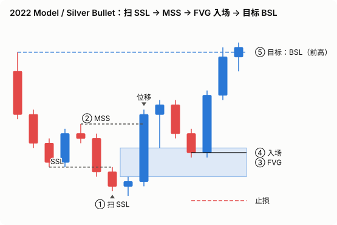
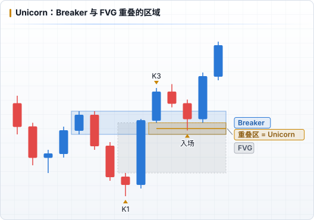

# 交易模型

模型 = 时间 + 流动性 + PD Array 的固定组合。每个模型都写成可执行的规则，并在日志 `setup` 字段中使用统一名称，才能被统计。

---

## Silver Bullet

| 项目 | 规则 |
|---|---|
| 时间 | 03:00–04:00 / 10:00–11:00 / 14:00–15:00（纽约） |
| 前提 | 明确的 DOL；时段内价格向 DOL 方向位移 |
| 入场 | 窗口内第一个指向 DOL 的 FVG，价格回撤进入时入场 |
| 止损 | FVG 形成前的摆动点外侧 |
| 目标 | DOL（最近的明显流动性） |
| 过滤 | 到目标的空间要足够覆盖止损，计划 R:R 至少 1.5 |

> 窗口内的形态与下方 2022 Model 示意图相同：扫流动性 → 位移 → FVG 回撤入场。

## 2022 Mentorship Model

1. 确定 HTF PD Array 和 DOL
2. Killzone 内价格 **扫掉一侧流动性**（如 London Low）
3. 出现反向 **位移**，形成 **MSS**，留下 FVG
4. 价格回撤到 FVG（或 OTE 区间）入场
5. 止损：扫流动性形成的高 / 低点外侧
6. 目标：对侧流动性



## Turtle Soup

- 价格突破一个明显的旧高 / 旧低（往往位于 HTF PD Array），随即收回
- 逆着假突破方向入场，止损在假突破极值外侧
- 本质：在流动性 **Raid** 处反向


## Unicorn

- **Breaker Block 与 FVG 重叠** 的区域
- 回撤到重叠区入场，止损在 Breaker 外侧
- 同时满足「流动性已被扫 + 结构转变 + 低效区」，质量通常较高



## OTE

- 在一段位移腿上画斐波那契，价格回撤至 **62%–79%** 入场
- 最好与 FVG / OB 重叠，并位于 HTF 的折价（做多）或溢价（做空）区

> 示意图见 [PD Arrays · OTE](./03-pd-arrays.md)。

## Judas Swing（London）

- 00:00 之后价格先向假方向移动（扫 Asia 高或低），随后反转走向真实方向
- 配合 Midnight Open：看涨日在 Midnight Open 下方寻找做多

---

## 写给自己的模型规则模板

为每个你实际交易的模型写一张卡片，复制下面的结构：

```markdown
### 模型名称：
- 适用品种：
- 时间窗口：
- 必要条件（全部满足才交易）：
  1.
  2.
- 入场触发：
- 止损：
- 目标 / 分批：
- 不做的情况：
- A+ 与 B 的区别：
```

A+ 的定义写清楚后，日志中的 `grade` 才有统计意义。
