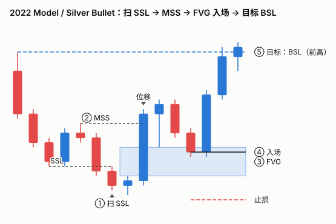
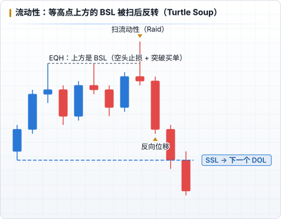
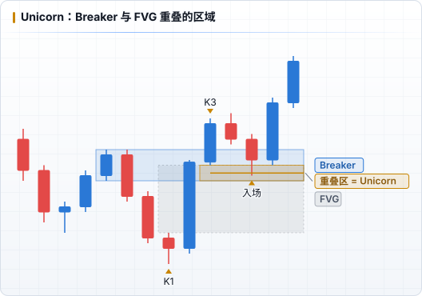

# 交易模型

模型 = 时间 + 流动性 + PD Array 的固定组合。每个模型都写成可执行的规则，并在日志 `setup` 字段中使用统一名称，才能被统计。

---

## Silver Bullet

| 项目 | 规则 |
|---|---|
| 时间 | 03:00–04:00 / 10:00–11:00 / 14:00–15:00（纽约） |
| 前提 | 明确的 DOL；时段内价格向 DOL 方向位移 |
| 入场 | 窗口内第一个指向 DOL 的 FVG，价格回撤进入时入场 |
| 止损 | FVG 形成前的摆动点外侧 |
| 目标 | DOL（最近的明显流动性） |
| 过滤 | 到目标的空间要足够覆盖止损，计划 R:R 至少 1.5 |

> 窗口内的形态与下方 2022 Model 示意图相同：扫流动性 → 位移 → FVG 回撤入场。

## 2022 Mentorship Model

1. 确定 HTF PD Array 和 DOL
2. Killzone 内价格 **扫掉一侧流动性**（如 London Low）
3. 出现反向 **位移**，形成 **MSS**，留下 FVG
4. 价格回撤到 FVG（或 OTE 区间）入场
5. 止损：扫流动性形成的高 / 低点外侧
6. 目标：对侧流动性



[教程](https://chanlunpp.org/basics-ict) 7.3 补充的细节（以做多为例）：

- 被突破的那个摆动点，应该和入场 FVG 的三根 K 线之一处在同一水平带；摆动点在扫流动性之前或之后形成都可以
- 在位移区间（从扫出的低点到 MSS 的高点）上画 50%：**入场 FVG 必须在 50% 上或更折价的一侧**，在溢价一侧的放弃
- 在 FVG 里挂限价，首选 CE；目标至少 1:2，理想 1:3 以上
- 最经典的时间是 08:30–11:00

## Turtle Soup

- 价格突破一个明显的旧高 / 旧低（往往位于 HTF PD Array），随即收回
- 逆着假突破方向入场，止损在假突破极值外侧
- 本质：在流动性 **Raid** 处反向
- 判定和两种参与方式见 [市场结构 · 机构级反转](./01-market-structure.md)。教程 7.6 的单独用法：一个短期低点被扫了两次，而上方的买方流动性一直没被碰，第二次扫就是 Turtle Soup 的买点



## Unicorn

- **Breaker Block 与 FVG 重叠** 的区域
- 回撤到重叠区入场，止损在 Breaker 外侧
- 同时满足「流动性已被扫 + 结构转变 + 低效区」，质量通常较高



## OTE

- 在一段位移腿上画斐波那契，价格回撤至 **62%–79%** 入场
- 最好与 FVG / OB 重叠，并位于 HTF 的折价（做多）或溢价（做空）区

> 示意图见 [PD Arrays · OTE](./03-pd-arrays.md)。

## Judas Swing（London）

- 00:00 之后价格先向假方向移动（扫 Asia 高或低），随后反转走向真实方向
- 配合 Midnight Open：看涨日在 Midnight Open 下方寻找做多
- 幅度和确认标准见 [时间与时段 · Judas Swing](./04-time.md)

## ATM（Anytime Money，教程 7.4）

1H 图上单独成立的形态，做空为例：

1. 1H 一段成熟的上涨，至少先后突破了两个摆动高点
2. 做出关键高点（Key High）之后，跌破一个短期摆动低点
3. 等价格回撤到「关键高点之前最后一个被突破的摆动低点」，它此时是一个 Breaker
4. 在 Breaker 回踩处做空，止损在关键高点或 Breaker 上沿外，目标是第二个短期低点下方

仍然要 HTF 方向不反对，并且在 Killzone 内。

## 做市商模型（MMXM，教程 7.5）

以卖出模型（MMSM）为例，买入模型（MMBM）镜像：

1. **初始整理**：低位窄幅震荡，下方埋着卖方流动性
2. **买程序**（左侧上行）：逐级扫掉空头止损，把价格送上去
3. 到达 HTF 溢价区的 PD Array，出现 SMR（见 [市场结构](./01-market-structure.md)），买程序结束；同时出现 SMT 背离更可靠
4. **卖程序**（右侧下行）：机构逐级派发
5. **终点**：初始整理区下方的卖方流动性

左侧上行段（**BDR**，Buy-side Delivery Range）用斐波那契切成四个 25%：第一段是初始整理，1–2 段之间有第一次再积累，**50% 处是 Measuring Gap**（从起点量到它再投影一倍可以校验），2–3 段之间是第二次再积累，最后一段几乎不回踩。右侧下行段（**SDR**）同样四段，价格会在左侧对应的再积累区逐个解套。

右侧的入场：

- **CSD**（Change in State of Delivery）：反转后价格向下穿过「扫买方流动性的最后一根阳线」的开盘价，这根阳线就是新鲜的看跌 OB，下跌段要带 FVG 才算。概念同 [CISD](./01-market-structure.md)
- 第一个入场：回踩这个 OB，不能收盘越过它的 MT
- 之后：跌破左侧第二次再积累区的低点，回踩那里的 FVG 或 Breaker 继续做空
- 入场工具三选一：2022 Model（最严格）、Breaker + FVG（最简洁）、OB 回踩

**终点校准**：三把尺交叉的地方，(a) 初始整理区下方的整数刻度（约 0.1–0.4 倍 ADR）；(b) 操纵段的 2–2.5 倍标准差投影；(c) HTF PD Array。

前提：HTF 订单流看跌、DOL 在下方、能认出「初始整理 + 买程序」的痕迹。

## 区间交易（教程 7.6）

框区间的四种方法：导致对侧被扫的那个极值；同侧被扫之前的极值；EQH / EQL；PDH / PDL、PWH / PWL 等，以 50% 线对得上成交密集区的为准（见 [PD Arrays](./03-pd-arrays.md)）。

横盘剧本：确认是区间 → 等高点被扫、价格反转跌破，留下看跌 Breaker → 回踩 Breaker 做空，止损在 Breaker 上沿外 → 目标是区间对侧的卖方流动性，到 50% 先减半仓。

## One Setup For Life（教程 7.8）

NY 时段的三层参考：

1. 前一天 13:30–16:00 的午后区间高低
2. 当天 London（02:00–05:00）区间的高低（开盘离午后区间太远时改用这个）
3. 当天 NY 上午（09:30–12:00）和午餐（12:00–13:30）的区间，给下午用

然后等 10:00–11:00 Silver Bullet 窗口里的位移确认，按 2022 Model 或 FVG 回踩执行。

---

## 写给自己的模型规则模板

为每个你实际交易的模型写一张卡片，复制下面的结构：

```markdown
### 模型名称：
- 适用品种：
- 时间窗口：
- 必要条件（全部满足才交易）：
  1.
  2.
- 入场触发：
- 止损：
- 目标 / 分批：
- 不做的情况：
- A+ 与 B 的区别：
```

A+ 的定义写清楚后，日志中的 `grade` 才有统计意义。
