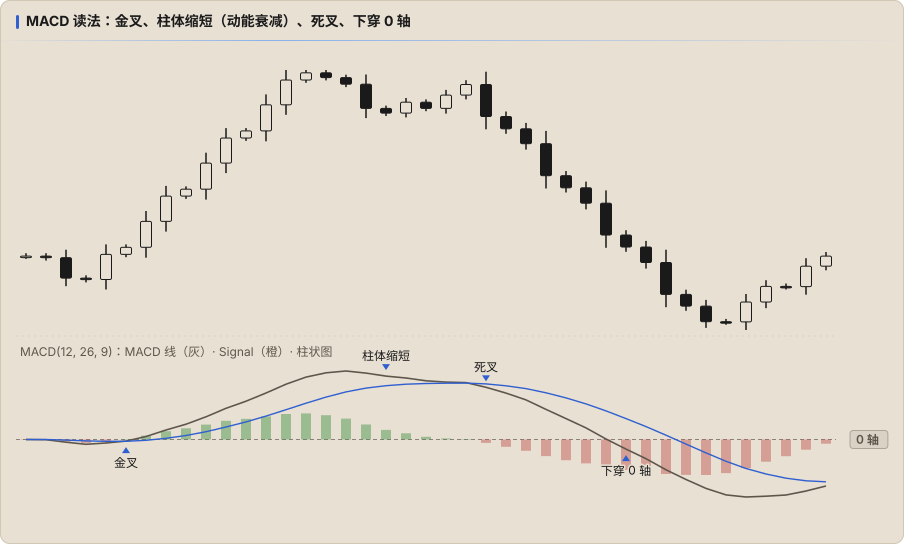

# MACD 信号与读法

## 1. 0 轴

- MACD 线 > 0：EMA 12 在 EMA 26 上方，短期趋势向上
- MACD 线 < 0：短期趋势向下
- **穿越 0 轴** 等价于 EMA 12 与 EMA 26 交叉，是比金叉死叉更慢、但更稳的趋势确认

## 2. 金叉 / 死叉

- **金叉**：MACD 线上穿 Signal 线；**死叉**：下穿
- 0 轴上方的金叉（顺势回撤后再起）比 0 轴下方的金叉（逆势反弹）更有意义，死叉反之
- 震荡市里金叉死叉非常频繁，单独使用胜率很低

## 3. 柱状图

| 现象 | 含义 |
|---|---|
| 柱体增长 | 动能加速 |
| 柱体缩短（仍在同一侧） | 动能减速，价格可能仍在走，但推力在减弱 |
| 柱体翻转到另一侧 | 即金叉 / 死叉 |

柱体缩短是 **最早** 的动能衰减信号，比交叉早，但也更容易出现假信号。

## 4. 背离

| 类型 | 价格 | MACD（线或柱状图） | 含义 |
|---|---|---|---|
| **看跌背离** | 更高的高点 | 更低的高点 | 上涨动能衰减，可能反转 |
| **看涨背离** | 更低的低点 | 更高的低点 | 下跌动能衰减，可能反转 |
| **隐藏看涨背离** | 更高的低点 | 更低的低点 | 上升趋势中的回撤，趋势可能延续 |
| **隐藏看跌背离** | 更低的高点 | 更高的高点 | 下降趋势中的反弹，趋势可能延续 |

- 和 RSI 背离一样，背离可以连续出现多次，需要价格结构确认
- 比较 MACD 线背离时，两个峰最好在 0 轴同一侧

## 常见误用

- 把金叉死叉当成入场信号，忽略滞后
- 在 1m 上看 MACD 背离，忽略 HTF 方向
- 不同品种之间比较 MACD 数值大小
