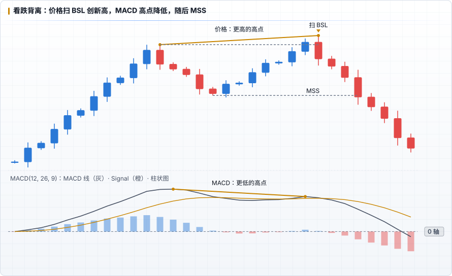

# MACD 与 ICT 结合

和 RSI 一样，MACD 在 ICT 框架里只能做 **辅助确认**，不能替代时间、流动性、PD Array 中的任何一个。

## 可以做的

| 场景 | MACD 的作用 |
|---|---|
| **扫流动性时的背离** | 价格扫掉前高（BSL）创新高，MACD 高点却降低 → 上涨动能没有跟上，扫高更可能是操纵，等待随后的 MSS / CISD |
| **HTF 动能过滤** | HTF（1H / 4H）MACD 在 0 轴上方且柱状图增长时，只在 LTF 找做多的 PD Array；与 [HTF Bias](../ict/05-htf-bias.md) 矛盾时降低仓位 |
| **回撤是否健康** | 上升趋势中回撤到折价区，HTF MACD 仍在 0 轴上方（只是柱体缩短或小死叉），说明大方向未变 |
| **目标附近减仓** | 价格接近 DOL 且 MACD 柱体连续缩短或出现背离，可作为分批止盈的参考 |

## 不该做的

- 没有扫流动性、没有 PD Array，只因为「MACD 金叉」就入场
- 等 MACD 交叉确认才入场，导致错过 FVG 回踩、止损被迫放大
- 用 LTF MACD 背离推翻 HTF Bias

## 一个组合流程示例

1. HTF：确定 Bias 和 DOL（ICT 原有流程）；HTF MACD 在 0 轴哪一侧？是否支持这个方向？
2. Killzone 内价格扫掉对侧流动性 → 检查 LTF MACD 是否背离
3. 出现 MSS / 位移并留下 FVG → 按原模型入场，MACD 不参与入场价和止损

## 记录方式

- 主要依据是 MACD 时，`strategy: MACD`；只是辅助确认时，保持 `strategy: ICT`，在 `tags` 里标记，如 `tags: [macd-divergence]`
- 积累 30 笔以上后，比较「有 MACD 背离」和「没有」两组的平均 R、胜率
