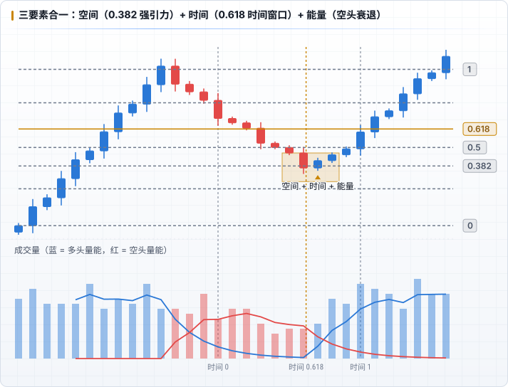

# 自然交易理论学习路线

整理自 WTT《自然交易理论基础与进阶》（BookDNA 电子版，2020）。书中只讲了**基础（S1）**和**进阶（S2）**两个阶段，高级阶段（S3）作者说留给线下授课，书里没有。

> 本目录是对书中内容的**转述和整理**，不是原文摘录。插图是按书中描述画的示意图（`pnpm diagrams` 生成），价格和成交量都是示意数据，不对应真实行情。

## 核心：三要素 + 心术

| 要素 | 工具 | 回答的问题 |
|---|---|---|
| **能量** | 成交量（Volume）的多空变化 | 方向：多还是空？ |
| **空间** | Fib 回撤 | 位置：在哪里开仓、平仓？ |
| **时间** | Fib 趋势时间 | 时机：什么时候可能出现波动？ |

除了 Fib 系列和成交量，**其他传统指标一律不用**（MA、MACD、KDJ、BOLL、RSI，以及支撑阻力、三角形、头肩顶、M 头 W 底）。作者把成功交易的权重算作「三分技术，七分心术」，心术贯穿全书。

书中对理想入场的比喻：豹子不会一直追着麋鹿跑，而是长时间观察、等待，等猎物处在没有退路的位置时才出手。对应到交易里，就是**在快要变盘的时间点（时间）、价格接近边缘的位置（空间），按正确的方向（能量）开单**。

## 适用范围

- 判断 **3 个月以内**的走势，单次判断最合适的周期是 **2–4 周**。
- **不适合判断以年为单位的大趋势**（见 [心术](./06-mindset.md) 中「自然交易与趋势」）。
- 适用于「充分博弈」的二级市场品种（股票、期货、外汇、加密货币等）。书中没给「充分博弈」下定义，按上下文理解是流动性充足、参与者多、没有单方控盘的品种。
- 书中示例几乎都是 BTC 永续合约的 **4H** 图。

## 学习路线

### 基础（S1）

| # | 主题 | 解决的问题 |
|---|---|---|
| 1 | [能量：交易量](./01-energy.md) | 怎么从成交量看多空力量的此消彼长？手绘量能曲线练习 |
| 2 | [空间：Fib 回撤](./02-fib-retracement.md) | 盒子怎么放？0、1、0.618 怎么定？ |
| 3 | [时间：Fib 趋势时间](./03-fib-time.md) | 三个锚点怎么选？「长短长」节奏，波动在哪根竖线附近发生？ |
| 4 | [引力](./04-gravity.md) | 价格为什么在某些 Fib 线附近反复徘徊？强引力和次引力 |
| 5 | [仓位控制](./05-position.md) | 杠杆、分仓、止损、止盈、加仓，交易资金从哪里来 |
| 6 | [心术](./06-mindset.md) | 心态准备、十条心术、绝对逻辑与随机博弈、追逐与停留 |

### 进阶（S2）

| # | 主题 | 解决的问题 |
|---|---|---|
| 7 | [Fib 通道](./07-fib-channel.md) | 斜着的 Fib 回撤，只用于长周期；量能消亡 → 通道失效 |
| 8 | [量能精进](./08-candle-strength.md) | 单根 K 柱里多空谁更强？绝对强势 / 相对强势 / 十字线 |
| 9 | [主次量能](./09-major-minor-volume.md) | 主量能 M 定方向，次量能 H / L 铺路 |
| 10 | [与 ICT 对照及记录方式](./10-with-ict.md) | 和 ICT 有哪些相通、哪些冲突？在日志里怎么记录？ |

### 进阶方法论：先做减法，再做加法

1. **减法**：一段时间内**只用成交量或只用 Fib 回撤其中一个**判断多空，借此把量能理解练扎实。
2. **加法**：分析量能的周期从 4H 扩展到 2H、1H，分别给出短期（1–3 天）、中期（3–7 天）、长期（1–4 周）的多空判断，开始关注更长周期的趋势和[主次量能](./09-major-minor-volume.md)。
3. **思维和心态**：理解博弈的逻辑，以及[追逐与停留](./06-mindset.md#追逐与停留)。

作者给的熟练周期是 **1 年**：每天至少 10 分钟分析判断，每月至少交易 3 次。

## 学习方法（书中建议）

1. **每天只学一章**，反复读、做作业，形成「肌肉记忆」。慢就是快。
2. 门槛是至少能看懂 K 线。
3. 作业：手绘量能曲线（第 1 篇）、自己画 Fib 趋势时间（第 3 篇）、找一段引力作用区域并描述逻辑（第 4 篇）。
4. 书中最后一再强调：**不要轻信任何人，包括作者本人**。

## 阅读时需要保留的判断

- **正确率数字没有出处**：书中说基础阶段能达到 60%+ 判断正确率，进阶 70%+，峰值 80%，「大部分人约 17%」。这些数字作者说来自导师和自己 10 年的统计，但没有给样本、方法和定义，**只能当作作者的主张，需要用自己的日志验证**。
- 书中自述的背景（管理约 16 万枚 BTC、学生交易大赛成绩）同样无法核实，不影响方法本身，但不要因此高估方法的可靠性。
- 书中有不少「玄学」「领悟」「感受」类的表述（作者自己也这么说），规则部分不像 ICT 那样可以逐条机械化。整理笔记时，**能落成规则的写成规则，靠主观感受的明确标注出来**。
- 仓位部分有些建议和以 R 为单位的风控思路有冲突（如亏损后补仓），详见 [仓位控制](./05-position.md#与以-r-为单位的风控对照)。
