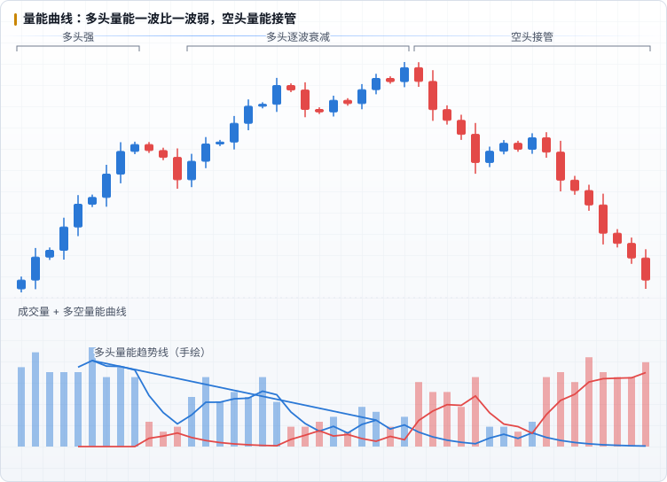

# 能量：交易量

**能量决定方向。** 自然交易理论里，成交量是判断多空的核心依据，Fib 只负责位置和时间。

## 比喻：战场与补给

书中用战争打比方：无论冷兵器时代攻城、热兵器时代打阵地战，还是今天的市场，战争的本质都是「**人、时间、补给**」三者的关系。进攻方不可能一直进攻，打一阵就要休整、补给；补给一断，战线就会被对方推回来。

成交量就是告诉你**过去某个时刻谁赢了这一仗**的指标。从历史上的输赢轨迹，可以推测接下来战局会怎么变。

> 能量守恒，此消彼长。

## 怎么看成交量

- 每根量柱的颜色代表这一段时间里**多头（上涨 K 线）或空头（下跌 K 线）**赢了。
- 重点**不是量柱高低的绝对值**，而是能量的**变迁、波动、增强与衰退**。
- 把成交量拆成两股能量分别观察：多头那一股是在一波比一波强，还是一波比一波弱？空头呢？

上图中，多头每次发力（阳线量柱）都比上一次弱，用手绘趋势线连起多头量能的波峰，能看到明显的下降；随后空头量能放大，价格转为下跌。

> 图中的两条曲线是把成交量按 K 线涨跌拆成两组后各自做 5 周期 EMA 平滑得到的（`calc.ts` 的 `energyCurves`），用来近似书中的「手绘量能曲线」。书中的曲线是凭感受手绘的，没有给出公式。

## 基础练习：手绘量能波动曲线

书中称这是**最重要的部分之一**：

1. **连续 3 个月只看 4H 图。**
2. 分析前，把分析周期内的**每一根量柱都仔细看一遍**，把它们想象成多空两个人的能量。
3. 可以手绘多头和空头的量能趋势线辅助感受。
4. 根据感受，**猜下一根量柱的颜色和高矮**。
5. **记录每一次判断是否正确。**

在本仓库里可以这样做：每天在当日日志（`journal/days/`）里记一条「下一根 4H 量柱：颜色 / 高矮」的预测，收盘后补对错，月底统计命中率。这比书里说的「神奇的事情会出现」更可检验。

## 进阶

- [量能精进](./08-candle-strength.md)：把视角缩小到单根 K 柱，看多空的绝对 / 相对强势。
- [主次量能](./09-major-minor-volume.md)：把视角放大到长周期，区分决定趋势的主量能和铺路的次量能。到这一步可以不再手绘曲线。
- [Fib 通道](./07-fib-channel.md)：用「量能消亡」判断通道失效。

## 要点

- 看量能判断的是**波浪的起伏，不是直角转弯**。
- **只看一方的量能，不能判断拐点**。
- 马太效应：一方取得优势后会强者越强，直到力竭懈怠，另一方才开始一步步夺回阵地。
