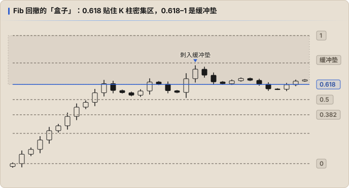

# 空间：Fib 回撤

**Fib 回撤决定空间**，也就是开仓、平仓的价位。

## 为什么只留 Fib

作者的逻辑：公式是人造的 → 指标是人造的 → 指标是主观的，所以不可靠（书中称单一价格指标的准确率不到 30%）。Fib 数列则是**先存在于自然界、后来才被人总结出来的**，所以和其他指标属性不同 —— 「所有的指标都是人造，唯独 Fib 是神造」。

> 这是作者的信念，不是可以证明的结论。真正需要验证的是：按书中方法画出来的 Fib 线，K 线是否真的高频触碰。

书中列了 10 种 Fib 工具（趋势扩展、回撤、时间周期、趋势时间、速度阻力扇、循环、螺旋、速度阻力弧、楔形、通道），**基础阶段只学 Fib 回撤和 [Fib 趋势时间](./03-fib-time.md)**，进阶加上 [Fib 通道](./07-fib-channel.md)。作者称这两个工具加上量能，能覆盖 80% 的交易情况。

## 画法：把 Fib 回撤想成一个「盒子」

只需要确定三样东西：**方向、上沿、下沿**。上下沿不一定是最高点和最低点。

使用的档位：`0 | 0.236 | 0.382 | 0.5 | 0.618 | 0.786 | 1`

### 方向

- **「0」永远是价格出发的位置，「1」永远是价格要去的方向。**
- 上涨：0 在下，1 在上。
- 下跌：0 在上，1 在下。
- 持续震荡：方向无所谓，盒子怎么翻都行。

> 注意：这和 ICT / 常见的回撤画法方向相反。常见画法从波段终点往回量，回撤 0.618 指「回吐了 61.8%」；书中的 0.618 是「从起点出发走了 61.8%」。同一根线，在两种画法里分别叫 0.618 和 0.382。

### 上沿和下沿

- **下沿（0）**：上涨时放在这段走势的最低点；下跌时放在最高点。
- **上沿**：理论上 1 就是这段走势的终点，但实际中 1 很容易被击穿。所以作者的做法是**把 0.618 当作这段走势的「顶」（下跌时是「底」）**，0.618–1 之间留作行情波动的**缓冲垫**。
- 调整 0.618 的位置时，让它**尽量贴住 K 柱最密集的区域**。

画对的标志：K 线会**高频触碰** Fib 回撤确定的价位。如果 K 线和这些线毫无关系，说明盒子放错了，重新调整。

## 练习

自己在 4H 图上反复画，先熟悉 0、1、0.618 三条线：

1. 选一段明显的上涨或下跌，按方向放 0。
2. 拖动 1，让 0.618 落在 K 柱最密集的区域。
3. 往后看：价格是否在 0.618、0.5、0.382 附近反复触碰？

## 下一步

价格为什么会在某些线附近反复徘徊、哪些线的作用更强，见 [引力](./04-gravity.md)。
