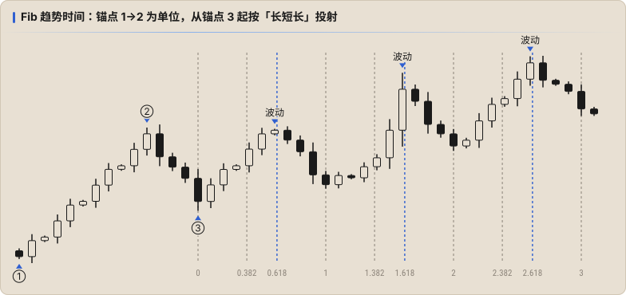

# 时间：Fib 趋势时间

**Fib 趋势时间决定时间**，也就是可能发生波动的时间点。TradingView 里的工具名是 **Trend-Based Fib Time**。

> Fib 趋势时间**不预测涨跌方向，也不预测开平仓价位，只预测波动可能在什么时候发生**。波动发生前，可以集中精力准备后续操作。

## 节奏：长短长

书中把它比作三拍子的华尔兹：**长、短、长**，不断重复。

| 区间 | 长度（单位） | 节奏 |
|---|---|---|
| 0 → 0.382 | 0.382 | 长 |
| 0.382 → 0.618 | 0.236 | 短 |
| 0.618 → 1 | 0.382 | 长 |
| 1 → 1.382 → 1.618 → 2 | 0.382 / 0.236 / 0.382 | 长短长 |
| 2 → 2.382 → 2.618 → 3 | 0.382 / 0.236 / 0.382 | 长短长 |

记住这个规律，能加快后续判断。

## 画法：三个锚点

- **锚点 1 → 锚点 2**：这两点之间的时长是「1 个单位」，决定了竖线之间的间距。两个点互相牵制，**一点点宽度的调整都会完全改变后面竖线的位置**（牵一发而动全身）。
- **锚点 3**：从这里开始投射竖线（0 线就在锚点 3）。
- 每条竖线的位置 = 锚点 3 + 比例 × (锚点 2 − 锚点 1)。

### 怎么判断画对了

- 设好锚点后，尽量让**已经走出来的部分**出现尽可能多的「长短长」波动，也就是让图形前段完美落在 K 线上。
- 竖线应该落在**有量能且波动相对较大的 K 柱**上。书中示例用黄色框标出这些已发生的吻合处，来确认图形有效；吻合越多，后面的竖线越可信。
- 时间范围以 **1–2 周**为宜，Fib 时间不适合判断太长的周期。

## 用竖线判断波动

1. **0.618 的位置是波动的高发区**（图中琥珀色竖线）。
2. 竖线**前后各 2 个单位时间**（如 4H 图上就是前后 2 根 K 线）都可以算作波动发生的位置。
3. 波动的方向和幅度要结合[量能](./01-energy.md)和 [Fib 回撤](./02-fib-retracement.md)位置综合判断。

不是每条竖线都会出现波动（上图 1.382 附近就没有明显波动），竖线只是提醒「这里值得关注」。

## 作业

根据自己的理解，在 4H 图上自己画 Fib 趋势时间。建议在日志里记下：锚点选在哪里、为什么，以及之后 1–2 周里哪些竖线附近真的出现了波动，以此检验画法。

到这里，三要素（能量、空间、时间）就讲完了。基础部分还剩最后一块：[引力](./04-gravity.md)。
