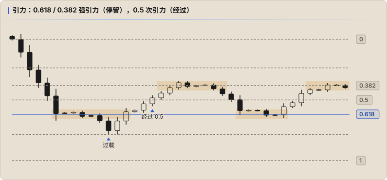

# 引力

引力是 Fib 回撤的深入内容，作者单独拿出来讲，是为了不干扰对三要素的学习。它补全了基础部分。

## 什么是引力

万物皆有引力，有质量的东西都在把别的东西往自己身上吸。K 线里也埋着无数引力点，作用是**把价格吸到自己所在的位置**。

回顾三要素会发现一个共性 —— **马太效应**（强者越强，弱者越弱）：在反转之前，价格一定会像被什么东西吸住一样走向一个极端，直到力竭（质量被消耗，或者出现了别的引力源），再被另一个质量吸向另一个方向，周而复始。

## 三种引力点

| 要素 | 引力点 |
|---|---|
| **空间** | Fib 回撤的黄金分割位，即 0.618、0.382 等 |
| **能量** | 量能放大点：成交量急剧堆积上升的地方 |
| **时间** | 趋势时间点：Fib 趋势时间 0.618 等时间分割点 |

## Fib 回撤里的引力强弱

价格会在 Fib 水平线附近反复徘徊，直到到达特定的时间点（Fib 趋势时间）或出现特定的量能变化，才发生变化。变化的幅度取决于引力大小：

| 强度 | 位置 | 表现 |
|---|---|---|
| **强引力** | 0.618、0.382 | 多次把价格吸过去，并且**停留**较久 |
| **次引力** | 0.5 | 价格会多次触及，但**不长时间停留** |
| 小 | 其他档位 | — |

上图是一段下跌（0 在上，1 在下）：价格先被 0.618 吸住横走，向下冲过头（过载）后又回到 0.618；之后向上**经过** 0.5 没有停留，被 0.382 吸住；再回到 0.618，再到 0.382。

## 过载

价格被吸向引力点时，接近后会冲过头，产生**过载（Overloaded）**；过载的能量耗尽后，波动趋于平静。

书中的比喻：手里甩一根绑着石头的松紧带。用力甩时，松紧带越拉越长；放慢时会收缩，而且缩得比原长还短；手停下后，松紧带在拉长和缩短之间来回摆，直到能量耗尽。

## 注意

- **0.618 和 0.382 不是拐点**。到了某个位置就反向开单是错的，多空仍然要靠[量能](./01-energy.md)判断。
- 作者明确说这部分「用语言不好描述，需要自己悟」，**书中没有给出可以机械执行的规则**。

## 作业

在 Fib 回撤里找出一段引力作用区域，尝试描述它的逻辑：是哪种引力点？价格停留了多久？什么时候、因为什么离开（时间到了？量能变了？）。
