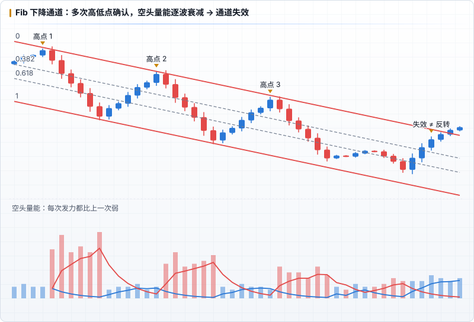

# Fib 通道

进阶部分的第一个工具。Fib 通道就是**斜着的 Fib 回撤**：选好上沿和下沿，就形成一个通道。在通道里，价格的运动相对可预测。

## 为什么放在进阶

1. 通道**引导性极强**，会很大程度影响开单判断，不适合初学者。
2. 需要先理解 [Fib 回撤](./02-fib-retracement.md)和[引力](./04-gravity.md)。
3. 通道只用于**辅助长期判断**，初学者把握不好长期趋势。

它是**辅助指标**：不用来判断方向和点位，而是加强对大局的认知，指导日常操作。

## 使用条件

> 通道图形**只能用于长周期判断**，而且必须出现**多次波段高 / 低点**之后才能确认有效。

这条决定了什么时候、从哪里开始观察 Fib 通道。

书中的例子（BTC 4H，近 2 个月）：通道的 0 线经过 14000、13000、12000 **三次高点**确认，1 线经过 9650、9080 **两次低点**确认，整个 K 线被放进 Fib 下降通道里。

## 通道的有效与失效：量能消亡

Fib 通道和量能最自然的结合，是**量能的消亡与通道的失效**。

在下降通道里空头处于绝对强势，所以**只看空头量能**：

- 第一次发力是空头最强的力量，开启了这个下降通道。
- 之后每次发力，空头量能逐渐衰减（像在巩固胜利、养精蓄锐），也可能再出现一次大的集中发力。
- 当空头**再次发力后量能衰减**，即可**初步判定通道失效**，不能再用。

书中的时间线：一个 4 个月的通道，第 1 个月结束时初步确认有效，第 2 个月结束时最终确认，直到出现量能消亡信号才判定失效。

## 失效 ≠ 反转

- **在长周期里，行情永远不会快速反转**。反转需要较长时间的能量积累。
- 用长线指标时，**不要想着抓拐点**，否则多次失败会让人很受挫。
- 通道失效后，回到 Fib 回撤和量能去判断接下来的走势。
- 分清短线和长线，控制好轻仓和重仓的时机。

## 不要做的事

- **不要用通道去预判每天的走势**，那是徒劳的。
- 不要迷信别人画的通道。很多时候别人只是随手一画，却被当成金科玉律。
- 不要因为进入进阶就忽略基础：作者说融会贯通基础部分已经能保证 60% 的正确率（这一数字的局限见 [学习路线](./00-overview.md#阅读时需要保留的判断)）。
