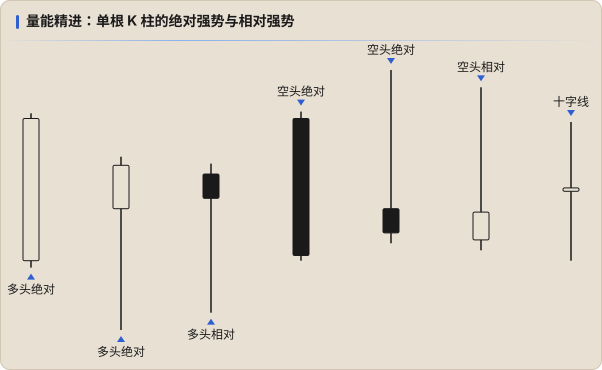

# 量能精进：单根 K 柱的多空强弱

> 空头软弱时，多头就更进一步；多头软弱时，空头就更进一步。

**量能精进的焦点是单根 K 柱**：从一根 K 柱上看多空在这段时间里的博弈结果，判断双方的**绝对强势**或**相对强势**。

## 定义

| 类型 | 多头 | 空头 |
|---|---|---|
| **绝对强势** | **阳线收盘**，带**长下影线**或**长实体** | **阴线收盘**，带**长上影线**或**长实体** |
| **相对强势** | 下影线远长于实体，**即使是阴线**；或阳线时实体与上影线旗鼓相当 | 上影线远长于实体，**即使是阳线**；或阴线时实体与下影线旗鼓相当 |

**十字线**：在震荡行情或拐点前出现得较多，结合绝对 / 相对强势综合判断。

## 四个等级和处理方式

| 等级 | 处理 |
|---|---|
| 1. 平庸 | 可以忽略，或纳入参考 |
| 2. 相对强势 | **必须**纳入参考 |
| 3. 绝对强势 | **重点**参考，可用来判断短期走势和开平仓点位 |
| 4. 均势 | 做好**拐点**的准备 |

> 书中没有明说十字线对应哪个等级。按文意，十字线（多空打平）最接近「均势」，这是我的理解。

## 量能精进的意义

持续交易的人很容易陷入「没单就不舒服」的状态：怕的往往不是亏损，而是**踏空**。焦虑久了，开单就容易失误，例如：

- 在 0.618 和 0.786 中间开单，结果价格上上下下，直到耗尽耐心；
- 按传统支撑阻力思路，跌破支撑做空、突破阻力做多，结果是更长时间的煎熬。

量能精进的重点**不是判断接下来的走势，而是提供更好的开平仓时机和点位**：根据单根 K 柱反映的多空强弱，更好地执行下一个极短周期里的操作 —— 开仓、补仓、减仓或平仓。

## 注意

- 这部分很容易让操作变得**频繁且激进**。不要买椟还珠。
- 必须**结合基础三要素**一起用，特别是 Fib 回撤和量能。单根 K 柱只决定「怎么执行」，不决定「做不做」。
