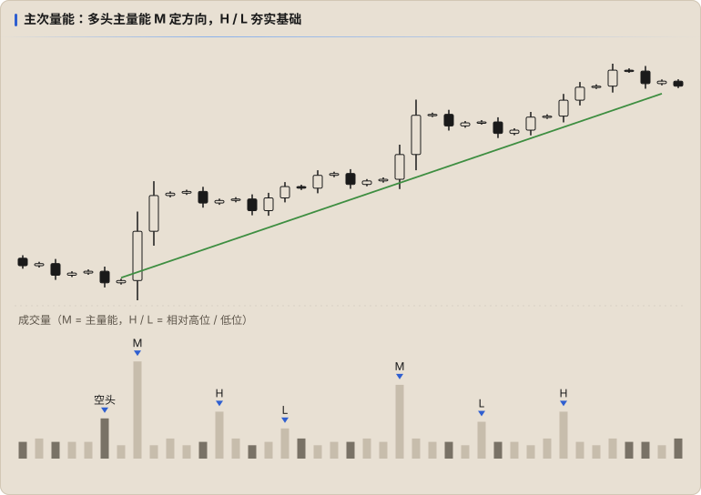

# 主次量能

> 世间万物，本无主次。主次之别，是人为了方便认知而定下的规则。

在长周期的成交量里，总有放量的时候，也总有成交低迷的时候。把量柱分出主次，是认识**趋势**最重要的规则之一，对长线判断影响很大。

## 定义

| 符号 | 名称 | 含义 |
|---|---|---|
| **M** | 主量能（Major） | 极高的量柱 |
| **H** | 相对高位 | 次要量能中较高的 |
| **L** | 相对低位 | 次要量能中较低的 |

## 怎么读

- **主量能决定趋势方向**：上图中最高的多头 M 开启了一段上涨，后面出现的多头 M 让上涨延续。
- **次量能影响短周期方向**，并「牺牲自己，为主量能铺平道路」：M 之下的多头 H、L 不断夯实多头基础，和不断出现的空头量能博弈、抵消，保住 M 带领的大趋势。

书中的比喻：主量能是正面战场的大战役，次量能是山间小道的游击战。

空头统治时反过来：多头持续发力、消耗了很多量能；空头的 H、L 不断发力，直到出现**空头 M**，空头大胜，再靠空头 H、L 巩固防线，多头节节败退。

## 为什么以前没发现

不是没发觉，而是**耐不住等这么长的时间**。如果把交易速度放到很慢，比如按周交易，就很容易判断未来一段时间的趋势。

## 要点

- 马太效应在量能里尤其明显：一方取得绝对优势后另一方很难反击，直到优势方力竭懈怠，另一方才趁机一步步夺回领地。
- 到这一步，可以不再[手绘量能曲线](./01-energy.md#基础练习手绘量能波动曲线)，改用「一分为二」（主 / 次）的视角剖析量能。
- **单看一方的量能，不能判断拐点**。看量能判断的是**波浪的起伏，不是直角转弯**。
- Fib 的 0.618、0.382 也**不是拐点**。多空需要判断，不是到了某个位置就能反向开单。
