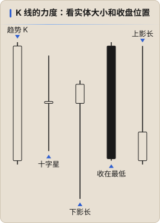

# K 线解读

一根 K 线是一段时间里多空博弈的结果。PA 读 K 线不看名字（锤子线、吞没……），只问两个问题：**谁赢了？赢得多干脆？**

## 看什么

| 看什么 | 怎么读 |
|---|---|
| **实体大小** | 实体越大，收盘方向那一方越强；实体很小说明双方打平 |
| **收盘位置** | 收在最高点附近 = 多头控制到最后；收在最低点附近 = 空头控制到最后；收在中间 = 没人赢 |
| **影线** | 长上影 = 上方有人卖、价格被打回；长下影 = 下方有人买。影线代表 **被拒绝的价格** |
| **和前一根的重叠** | 和前几根重叠很多 = 犹豫、可能是区间；几乎不重叠 = 单边、有力度 |
| **大小和周围比** | 一根 K 线强不强要和最近的 K 线比，同样 10 个点，在窄幅震荡里是大 K，在急涨里是普通 K |

## 两类 K 线

- **趋势 K（Trend Bar）**：实体大、影线短、收在极值附近。连续几根同向趋势 K = 有力度的单边。
- **十字星（Doji）**：实体很小，上下影线都有。多空打平，单独出现没有方向含义；在趋势里出现说明动能在减弱，在区间里出现很正常。

## 常见误区

- **阳线 ≠ 多头强**。阳线但上影很长、收在中间偏下，多头其实没守住（图中最右）。
- **只看一根**。一根强 K 线后面没有跟进，力度就要打折扣。读 K 线要看它和 **后面 1–2 根** 的关系：有没有跟进、有没有被吞掉。
- **忽略位置**。长下影在下跌末端、扫完前低之后出现，比在区间中间出现有意义得多（见 [信号 K](./02-signal-bar.md)）。

## 和其他笔记的关系

- 自然交易理论的 [量能精进](../natural-trading-theory/08-candle-strength.md) 也是从单根 K 柱看多空强弱，分绝对强势 / 相对强势，可以对照着看。
- ICT 的 **位移（Displacement）** 就是连续的大实体趋势 K，通常会留下 FVG；Keyshot 认为 FVG 本身就是力度的表现。[↗](https://x.com/Keyshotvv/status/2103442126629679495)
