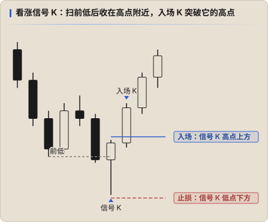

# 信号 K 与入场

**信号 K（Signal Bar）**：让你决定进场的那根 K 线。**入场 K（Entry Bar）**：价格突破信号 K、触发你进场的那根 K 线。

## 好的信号 K

以看涨信号 K 为例（看跌反过来）：

| 条件 | 说明 |
|---|---|
| **收在高点附近** | 最重要的一条：多头控制到收盘 |
| **阳线，实体不小** | 阴线也可以做信号 K，但力度弱一档 |
| **有下影线** | 说明下方的价格被拒绝 |
| **和前几根重叠不多** | 重叠太多说明还在犹豫 |
| **大小适中** | 太大的信号 K 止损也大，盈亏比差；太小说明力度不够 |
| **出现在对的位置** | 趋势回调的末端、扫完前低 / 等低之后、区间下沿 |

**位置比形态重要**。一根完美的看涨信号 K 出现在下跌中途、没有任何关键点位，也不值得做。

## 怎么进场

| 方式 | 做法 | 优缺点 |
|---|---|---|
| **突破信号 K 挂单** | 在信号 K 高点上方 1 跳挂 buy stop，止损放在信号 K 低点下方 | 传统 PA 做法；没有跟进就不会成交 |
| **等入场 K 收盘** | 入场 K 收盘确认突破后再进 | 更稳，但进场价更差 |
| **在信号 K 内部回调进** | 等价格回到信号 K 的中部或 FVG 再进 | 盈亏比好，但可能错过 |

Keyshot 的变化：2026-02 学 PA 时常在信号 K 外挂 stop 单 [↗](https://x.com/Keyshotvv/status/2027546829995577573)；**2026-10 起改为看到反应再进，不提前挂单**，并且一切等 K 线收盘再判断。[↗](https://x.com/Keyshotvv/status/2115004115344577015) [↗](https://x.com/Keyshotvv/status/2110041074052034645)

## 止损

- 默认放在 **信号 K 的另一端外面**（看涨放在低点下方）。
- 信号 K 太大时，可以用结构上更有意义的位置（前低、扫点的极值），但不要为了盈亏比硬拉近。
- 信号 K 被反向突破 = 这个信号失败。失败本身也是信号：多头在这里没守住，对手方会顺势推。

## 好的进场之后

Keyshot 的标准：好的交易进场后 **下一根 K 线就该出利润**，并且一路走到目标。[↗](https://x.com/Keyshotvv/status/2103297656315650074) 入场后几根 K 线都在原地磨，说明力度不够，要考虑提前离场。

## 高级别信号 K

信号 K 不只出现在小周期。日线、周线、月线在多个关键点位收出信号 K，有效性很高。[↗](https://x.com/Keyshotvv/status/2115286077598843029) 大级别信号 K 也常常是持仓结束的信号，例如 4H 出现巨大的反转信号 K 时部分止盈。[↗](https://x.com/Keyshotvv/status/2112545991069221001)
