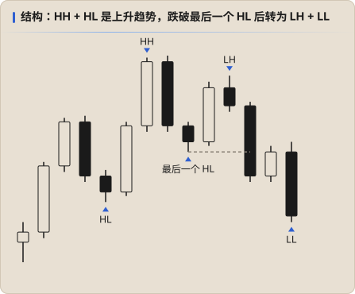
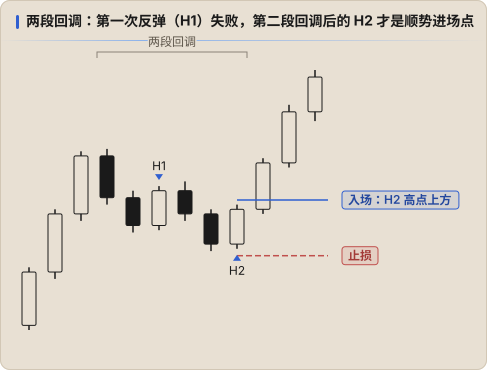

# 结构

结构回答的是 **背景**：现在是涨、是跌，还是震荡？PA 对结构的定义和 ICT 的 [市场结构](../ict/01-market-structure.md) 基本相同，这里只讲 PA 的读法。

## 摆动点

| 结构 | 含义 |
|---|---|
| **HH + HL**（更高的高点 + 更高的低点） | 上升趋势 |
| **LH + LL**（更低的高点 + 更低的低点） | 下降趋势 |
| 高点和低点都差不多 | 区间 |

**最后一个 HL** 是上升趋势的「生命线」：被跌破之前，回调都只是回调；跌破之后，至少说明趋势不再那么强，常常会变成区间或反转。Keyshot 说 MSS 本质上就是 HH / HL 的结构变化。[↗](https://x.com/Keyshotvv/status/2115468748287254980)

## Always In：现在该站哪一边

PA 常用 **Always In** 来概括当前方向：假设你必须一直持有多单或空单，现在应该拿哪一边？

- 刚出现连续的大实体趋势 K、突破了重要的摆动点 → Always In 转向那一边
- 方向不明显（K 线重叠、十字星多）→ 当作区间，两边都不站

判断不了 Always In 的时候，就是不该做趋势单的时候。

## 回调：H1 / H2 与 L1 / L2

上升趋势里的回调，常常走 **两段**：

- **H1**：回调中第一次出现的「高点高于前一根 K 线高点」，第一次尝试反弹
- **H2**：第一次反弹失败后，第二段回调结束时的第二次尝试

在强趋势里 H1 就可以做；在一般趋势里，**H2 更可靠**，因为两段回调让逆势的一方试过两次都没成功。下降趋势里对应的是 L1 / L2。

Keyshot 也提到过类似的规律：1H 空头趋势里，不要指望一个三段上涨就直接反转。[↗](https://x.com/Keyshotvv/status/2027548187058385111)

## 结构要看哪个周期

- 方向看 **日线和 4H**：一眼看上去是涨就是涨，是跌就是跌。[↗](https://x.com/Keyshotvv/status/2092992686295048459)
- 小周期的结构只用来找进场，不要用它推翻大周期的方向。
- 「再次跌破」才构成完整结构，第一次跌破可能只是清扫单个波段。[↗](https://x.com/Keyshotvv/status/2099393342840926521)
