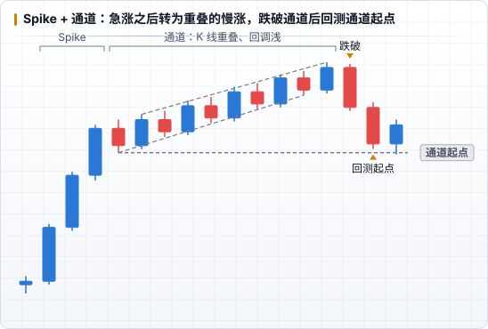

# 趋势与通道

PA 把趋势分成两个阶段：**Spike**（急涨急跌）和 **通道**（慢涨慢跌）。大多数趋势是先 Spike、再通道。

## Spike 和通道

| | Spike | 通道 |
|---|---|---|
| K 线 | 连续大实体趋势 K，几乎不重叠 | 实体变小，K 线重叠多，有反向 K |
| 回调 | 几乎没有 | 有，但浅 |
| 含义 | 一方压倒性胜利，常常在突破关键位置时出现 | 趋势还在，但对手方开始参与 |
| 怎么做 | 不逆势；等第一次回调顺势进 | 顺势在通道下沿（上升）附近找信号 K；不在上沿追 |

ICT 的 **位移** 对应的就是 Spike。

## 强通道和弱通道

| 强通道 | 弱通道 |
|---|---|
| 斜率陡，回调很浅、很短 | 斜率缓，回调深，K 线重叠多 |
| 反向的信号 K 大多失败 | 两边都有人赚钱，看起来像「向上倾斜的区间」 |
| 只顺势做 | 顺势做为主，也会出现不错的逆势机会 |

## 通道就是趋势

Keyshot 反复强调：**通道 = 趋势**，用流动性逻辑一定要回避逆着通道做；想参与就等右侧结构出来。[↗](https://x.com/Keyshotvv/status/2111819239971782931) 通道里留下的每个摆动点都是对手盘的燃料，传统意义上的支撑会被逐个击破。[↗](https://x.com/Keyshotvv/status/2112560339304989159)

这也是为什么「等高 / 等低」的反例是通道和楔形：通道里的高点看起来差不多高，但那是趋势在推进，不是流动性池。[↗](https://x.com/Keyshotvv/status/2094667300700061778)

## 通道怎么结束

- **弱通道大概率被突破，并回测通道起点**。[↗](https://x.com/Keyshotvv/status/2024634086892196318) 上升通道被跌破后，第一目标是通道开始的地方（图中 Spike 结束后的第一个低点）。
- 通道末端常出现 **三推楔形**、**最后的旗形（Final Flag）**，见 [常见形态](./06-patterns.md)。
- 跌破通道不等于反转：常见的结果是先回到通道起点，再进入区间。

## 第二段

一段强势的 Spike（比如一根很大的阴线）之后，往往还会有 **第二段** 同方向的走势。[↗](https://x.com/Keyshotvv/status/2026918138533785686) 所以 Spike 后的第一次反弹通常不是反转，而是给顺势方的第二次机会。
