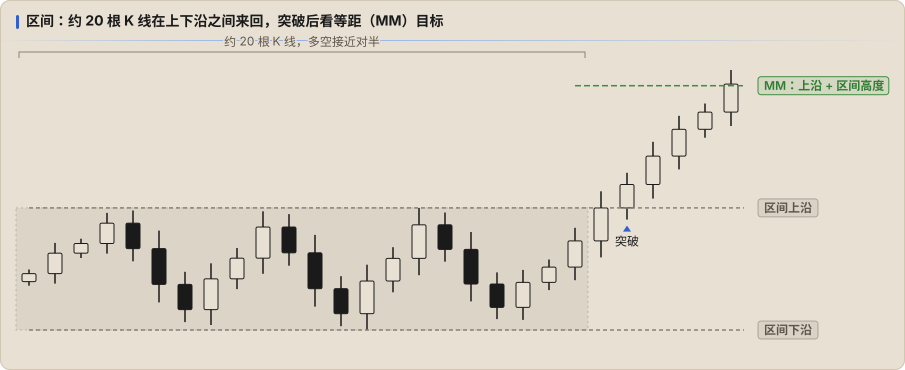

# 区间

市场大部分时间在区间里。区间里的规则和趋势相反：**突破大多失败，在边缘反向做**。

## 怎么认出区间

- K 线重叠多，十字星多，阴阳交替
- 高点和低点都差不多，没有持续的 HH / HL 或 LH / LL
- 均线走平，价格在均线上下来回穿
- 突破上沿 / 下沿后很快收回

## 区间里怎么做

| 原则 | 说明 |
|---|---|
| **低买高卖** | 在下沿附近找看涨信号 K，在上沿附近找看跌信号 K |
| **不在中间做** | 区间中间没有优势，盈亏比也差 |
| **突破先当作假突破** | 区间边缘的突破大多会失败，见 [突破与失败突破](./07-breakouts.md) |
| **目标给近一点** | 区间里很难走很远，目标放在对侧边缘或区间中线 |

Keyshot 的经验：以前用均线思维总想吃一大波，忽略了当时其实是 1H 区间，利润回撤了一半；目标要用 **同级别明确的目标位**。[↗](https://x.com/Keyshotvv/status/2025597362329252010)

## 时间越长，越接近对半

横盘持续约 **20 根 K 线** 后，多空的概率接近 **50% 对 50%**，向上、向下的目标都按等距（MM）来看。[↗](https://x.com/Keyshotvv/status/2027215067696222581) 这时候不要预设方向，等突破后的力度来告诉你答案。

## 等距目标（MM，Measured Move）

区间被有效突破后，常见的目标是 **突破位 + 区间高度**：

- 向上突破：目标 = 上沿 + （上沿 − 下沿）
- 向下突破：目标 = 下沿 − （上沿 − 下沿）

同样的思路也用在 Spike 上：Spike 的长度常常被复制一次。到了明确的 MM 目标就该走，不走就是贪。[↗](https://x.com/Keyshotvv/status/2025600280101085246)

## 区间和流动性

区间的上下沿就是 **等高 / 等低**：止损单堆在外面，是流动性池。ICT 的 Turtle Soup、Keyshot 的「假突破」模型，都是在区间边缘等这些流动性被扫掉后反向进场（见 [ICT + PA](./08-with-ict.md)）。
