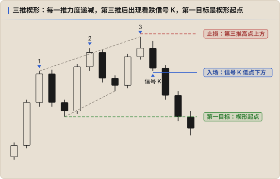

# 常见形态

形态是 **信号 K + 结构** 的组合，不是独立的系统。每个形态都要回答同样的问题：背景是什么？在什么位置？信号 K 够不够强？

## 三推楔形（Wedge）

- 三次推高（或推低），每一推的力度越来越弱：K 线变小、影线变长、新高越来越少
- 两条边线收敛
- 第三推之后出现反向信号 K 才进场，不在第三推的途中猜顶

**目标**：三推之后大概率走成区间，而不是直接反转。第一目标是 **楔形起点**（通道起点），第二目标才是区间的等距，所以要 **分批止盈**。[↗](https://x.com/Keyshotvv/status/2025599941318779062)

Keyshot 在 ICT 阶段常用「三推进入 HTF PDA」的 setup：三推过程中不能留下太多 PDA，回调要有规律，最后一推进入大级别 OB / FVG。[↗](https://x.com/Keyshotvv/status/2055336475064242648) 他也把标准的 MACD 背离理解为弱通道里的三推楔形。[↗](https://x.com/Keyshotvv/status/2025458802930450515)

## 旗形（Flag）

- **牛旗 / 熊旗**：Spike 之后一段小的反向整理，通常是 H2 / L2 式的两段回调，之后顺势继续
- **最后的旗形（Final Flag）**：趋势末端的一个旗形，突破后走不远就反转。区别在背景：趋势已经走了很久、出现了楔形或 Spike 的力度在减弱

判断方法：旗形突破后 **有没有跟进**。有跟进是普通旗形；突破 K 没有跟进、很快被吞掉，就可能是最后的旗形。

## 双顶 / 双底

- 价格两次测试差不多的高点（或低点）都没有突破
- 第二次测试时力度更弱（K 线更小、影线更长）
- 第二个顶 / 底出现信号 K 后进场，目标是中间的回调点，再往后看等距

双顶双底其实就是 **等高 / 等低**。在 ICT 和 Keyshot 的框架里，等高等低更常被当作 **流动性**：价格往往先突破它、扫掉止损，再反转（见 [突破与失败突破](./07-breakouts.md)）。所以更好的做法是 **等它被扫后的反转**，而不是在第二个顶直接做空。

## 头肩

头肩是「更低的高点 + 跌破颈线」，本质就是 [结构](./03-structure.md) 里的 HH / HL 转为 LH / LL。Keyshot 学 PA 时做过：把整体看成头肩，跌破右侧趋势线后在信号 K 下方挂单，期待去头部区域拿流动性。[↗](https://x.com/Keyshotvv/status/2028386131872813415)

## 不要给自己上枷锁

不用执着于「几推几推」，形态只是帮助描述走势。[↗](https://x.com/Keyshotvv/status/2100251397489127745) 一个形态不标准但力度和位置都对，比一个标准形态出现在错误的位置更值得做。
