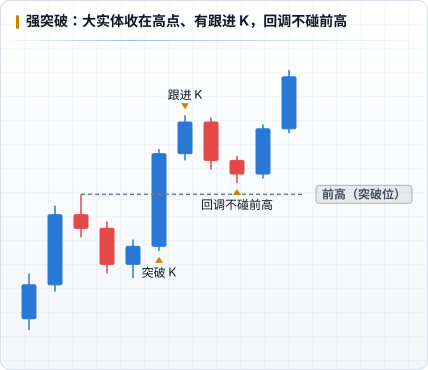

# 突破与失败突破

市场一直在尝试突破和反转，但 **大约 80% 都会失败**，因为市场有惯性。[↗](https://x.com/Keyshotvv/status/2021969588305768855) 这是 PA 最重要的统计事实之一，也是「把所有突破都先当作假突破」的依据。[↗](https://x.com/Keyshotvv/status/2114015048511459504)

## 强突破长什么样

| 特征 | 说明 |
|---|---|
| **突破 K 大实体、收在极值** | 一根就干脆地越过关键位置 |
| **有跟进 K** | 突破后下一根继续同方向收盘，而不是立刻十字星或反向 |
| **留下缺口** | 突破后回调没有回到突破位，中间留下空间（ICT 里就是 FVG） |
| **回调浅** | 回调的影线不碰前高最强，实体不碰前高次强 [↗](https://x.com/Keyshotvv/status/2027280580669509889) |

强突破之后的第一次回调，通常是顺势进场的机会。

## 失败突破（假突破）

- 价格突破区间边缘 / 等高点，但 **没有跟进**
- 很快出现反向信号 K，**收回区间里面**
- 进场：反向信号 K 的另一端被突破时；止损：突破的极值外面；目标：区间对侧

失败突破为什么有效：突破时追进去的人和原来在边缘外挂止损的人都被套，他们离场会推动价格往反方向走。

## 怎么区分

| 看什么 | 真突破 | 假突破 |
|---|---|---|
| 背景 | 顺大级别方向、Spike 之后 | 逆大级别方向、区间里、楔形末端 |
| 突破 K | 大实体、收在极值 | 长影线、收回边缘附近 |
| 下一根 | 继续同向 | 十字星或反向 K |
| 回调 | 不回到突破位 | 直接收回区间 |

判断要等 **K 线收盘**：盘中刺穿不算，收盘站稳才算突破，收盘收回才算失败。[↗](https://x.com/Keyshotvv/status/2110041074052034645) 判断关键低点是否被击穿，Keyshot 看的是 **日线收盘价**。[↗](https://x.com/Keyshotvv/status/2115087821715513497)

## 和 Keyshot 的模型

Keyshot 2026-08 把自己的模型总结为：**假突破 = 等高 / 等低被突破后的反转**。做空等等高被突破，出现本级别信号 K 就进，或者等次级别走出 N 字结构再进。[↗](https://x.com/Keyshotvv/status/2092976314240348515) 这就是 PA 的失败突破，只是用 ICT 的流动性来选位置（见 [ICT + PA](./08-with-ict.md)）。

两个限制：

- 经典的海龟汤要求 **多个** 等高 / 等低，而不是单个高低点。[↗](https://x.com/Keyshotvv/status/2092982433004359836)
- 跌得太远、破位的地方没有任何反应，就不算有效的清扫。[↗](https://x.com/Keyshotvv/status/2104411719317721236)
