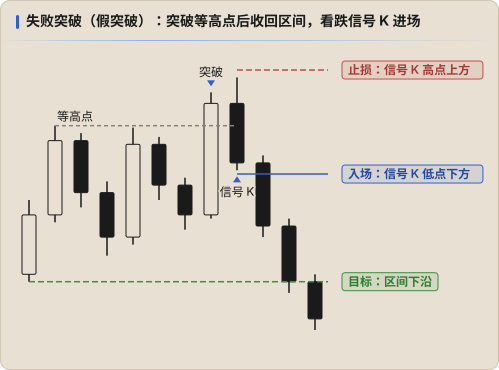

# ICT + PA：力度 + 流动性

> 依据 Keyshot 2026-10-28 的图片帖（回答「PA 和 ICT 思路不同，该怎么结合」）整理，转述，不是原话。[↗](https://x.com/Keyshotvv/status/2115468748287254980) 标了「整理」的部分是我的补充，不是他的说法。

一句话：**PA 看力度，ICT 看流动性**。力度 + 流动性就能组合出很多交易策略，其他东西都是锦上添花。

## 分工

| | 只用什么 | 用来判断 |
|---|---|---|
| **PA** | **信号 K** | 力度：价格到了这里，反应够不够强 |
| | **结构** | 背景：现在是涨、是跌，还是区间 |
| **ICT** | **流动性** | 价格要去哪里、在哪里等 |

PA 不用形态名、不用指标；ICT 不用复杂的模型和时间理论。两边各取一样最核心的东西。

## 为什么只学 ICT 不够

ICT 的概念被讲得很复杂，不容易理解。他把它们还原成更简单的东西：

| ICT 概念 | 还原成 | 详细见 |
|---|---|---|
| **CISD** | 大级别的信号 K | [信号 K 与入场](./02-signal-bar.md) |
| **MSS** | HH / HL 的结构变化 | [结构](./03-structure.md) |
| **FVG** | 力度的表现 | [K 线解读](./01-bars.md) |
| **CHOCH** | 波段中的流动性 | [突破与失败突破](./07-breakouts.md) |

整理：这样一还原，ICT 里大部分「进场确认」其实都在描述力度，可以交给 PA；ICT 真正不可替代的只剩 **流动性在哪里**。他之前也说过本级别的 CISD = 次级别的 MSS [↗](https://x.com/Keyshotvv/status/2045135925878132980)，FVG 本质是清扫了组成它的第三根 K 线的高低点 [↗](https://x.com/Keyshotvv/status/2103354626586423592)。

## 两者互补：目标和力度

| | PA | ICT |
|---|---|---|
| 有没有明确的目标 | 没有 | 有：对侧的流动性 |
| 到不了目标怎么办 | 看力度决定要不要提前平仓 | 没有答案 |

ICT 负责告诉你 **该去哪里**，PA 负责告诉你 **还去不去得了**。价格有时到不了目标，这时就用 PA 观察力度，看是否提前平仓。

## 学法：只抓「观察、进、平」

抛开所有冗余的概念，从 **怎么观察市场、怎么进、怎么平** 出发，只抓重点。下面按这三步整理（整理，依据他的规则）：

### 1. 怎么观察市场

| 用什么 | 看什么 |
|---|---|
| PA 结构 | 日线 / 4H 是涨还是跌？是 Spike、通道还是区间？通道里不逆势做 [↗](https://x.com/Keyshotvv/status/2111819239971782931) |
| ICT 流动性 | 关键点位在哪里：多个等高 / 等低、HTF 摆动点、50%、PDH / PDL；等高等低按自己交易的级别定义 [↗](https://x.com/Keyshotvv/status/2115435113014346129) |

观察的结论只有两句话：**方向是什么、在哪里等**。

### 2. 怎么进

| 用什么 | 看什么 |
|---|---|
| ICT 流动性 | 价格扫过了关键点位 |
| PA 信号 K | 扫完之后出现有力度的信号 K，**等 K 线收盘** [↗](https://x.com/Keyshotvv/status/2110041074052034645) |

有反应就进，没有就不进。[↗](https://x.com/Keyshotvv/status/2115004115344577015) 止损放在信号 K 或扫点极值的外面。

### 3. 怎么平

| 用什么 | 看什么 |
|---|---|
| ICT 流动性 | 目标就是对侧的流动性：内部流动性 → 外部流动性；DOL 不要定得太远 [↗](https://x.com/Keyshotvv/status/2113676587937976538) |
| PA 力度 | 进场后下一根 K 线就该出利润 [↗](https://x.com/Keyshotvv/status/2103297656315650074)；走不动、出现反向的大信号 K，就提前平仓 [↗](https://x.com/Keyshotvv/status/2112545991069221001) |

## 其他都是锦上添花

整理：按这个思路，下面这些东西他已经放弃或明确说过不必看：

- SMT：建议别看，直接从流动性本质制定策略 [↗](https://x.com/Keyshotvv/status/2105561595384623260)
- 季度理论、TGTSF：容易先入为主，忽视走势本身 [↗](https://x.com/Keyshotvv/status/2096406629751427128)
- 「几推几推」之类的计数：别给自己上枷锁 [↗](https://x.com/Keyshotvv/status/2100251397489127745)

不是说这些没用，而是在信号 K、结构、流动性三样都看清之前，加别的只会更乱。

## 用自己的交易对照

整理：[2026-10-28 XAU 做空](../../journal/trades/2026/2026-10-28-xauusdt-01.md) 按这三步看：

| 步骤 | 首笔（13:21） | 第二次加仓（21:27） |
|---|---|---|
| 观察：结构 | 日线下跌，中继反弹 | 同左 |
| 观察：流动性 | 1H / 4H 多个等高点 4072–4073.6 | 15m 等高点 4063.6–4065.9 |
| 进：力度 | 4H 信号 K 收在最低点，等收盘才进 | 15m、1H 都没收盘，看不到反转 |
| 平 | 止损 4080 被打，流动性目标 3979 没到 | 同左 |

流动性的位置两次都找对了，差别在 **力度有没有确认**。

## 不该做的

- 只因为出现了一根漂亮的信号 K 就进场，背后没有流动性、没有大级别背景
- 只因为价格到了某个 PDA 就进场，没等到任何 PA 反应
- 用形态名（双顶、头肩）代替流动性分析：双顶的第二个顶常常就是被扫的等高点
- 在通道里用「等高点被扫」做逆势单

## 记录方式

- 按这个框架做的交易保持 `strategy: ICT`，在 `tags` 里标记 PA 部分，如 `tags: [pa-signal-bar, failed-breakout]`
- 纯 PA 的交易（区间里低买高卖、H2 顺势）用 `strategy: PA`，在 `setup` 写形态（`H2`、`Wedge`、`Failed Breakout`、`Range`）
- 积累样本后比较：扫完流动性后 **有强信号 K** 和 **没等信号 K** 的两组，平均 R 和胜率差多少
