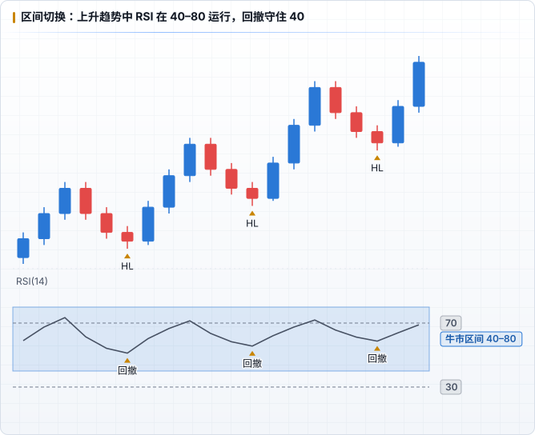
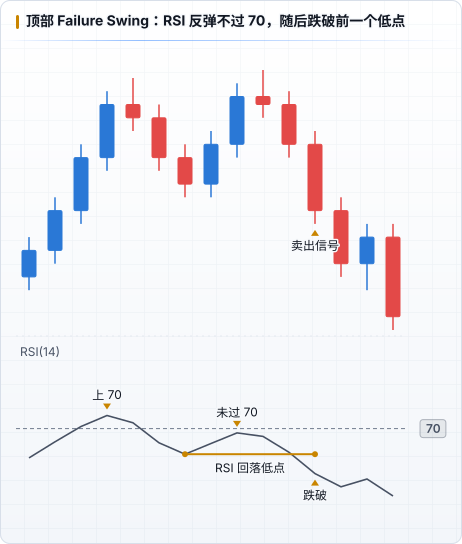

# RSI 信号与读法

## 1. 超买 / 超卖

- 传统阈值：**> 70 超买，< 30 超卖**（也有人用 80/20）
- 超买 ≠ 要跌，超卖 ≠ 要涨。强趋势中 RSI 可以在极值区停留很久
- 更合理的读法：**RSI 从极值区回到区间内**（如从 75 跌回 70 下方）才说明动能开始减弱

## 2. 区间切换（Range Shift）

Andrew Cardwell、Constance Brown 等人强调：趋势会改变 RSI 的「常驻区间」。

| 趋势 | RSI 常见区间 | 回撤时通常守住 |
|---|---|---|
| 上升趋势 | 40 – 80 | 40 – 50 一带 |
| 下降趋势 | 20 – 60 | 50 – 60 一带 |

- 上升趋势中 RSI 回到 40–50 而不破，往往是顺势回撤，而不是「超卖」
- RSI 从熊市区间切到牛市区间（回撤不再跌破 40、上冲能过 70），是趋势转变的辅助证据
- **50 线**：在 50 上方 = 多头占优，下方 = 空头占优，是最简单的动能过滤

## 3. 背离（Divergence）

| 类型 | 价格 | RSI | 含义 |
|---|---|---|---|
| **常规看跌背离** | 更高的高点（HH） | 更低的高点（LH） | 上涨动能衰减，可能反转 |
| **常规看涨背离** | 更低的低点（LL） | 更高的低点（HL） | 下跌动能衰减，可能反转 |
| **隐藏看涨背离** | 更高的低点（HL） | 更低的低点（LL） | 上升趋势中的回撤，趋势可能延续 |
| **隐藏看跌背离** | 更低的高点（LH） | 更高的高点（HH） | 下降趋势中的反弹，趋势可能延续 |

注意事项：

- 背离可以 **连续出现多次** 而价格继续走，单独的背离不是入场信号
- 比较的必须是 **对应的摆动点**（价格的两个高点对应 RSI 同一时间的两个峰）
- 背离只在 **有意义的位置** 才有价值（见 [与 ICT 结合](./03-with-ict.md)）

## 4. Failure Swing（Wilder 原始信号）

不看价格，只看 RSI 自身的结构：

- **顶部 Failure Swing**：RSI 上破 70 → 回落形成低点 → 反弹但未能再上 70 → **跌破前一个低点** = 卖出信号
- **底部 Failure Swing**：RSI 下破 30 → 反弹形成高点 → 回落但未再下 30 → **突破前一个高点** = 买入信号

本质上是在 RSI 上做「结构破坏」，和价格上的 MSS 思路相同。

## 常见误用

- 逆着强趋势抄「超买 / 超卖」
- 在 1m 上看到背离就入场，忽略 HTF 方向
- 多个周期 RSI 互相矛盾时，挑对自己有利的那个
