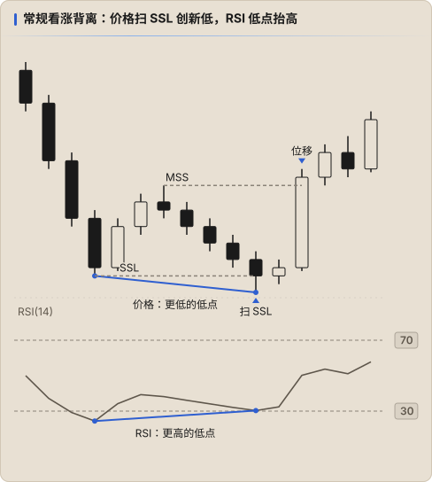

# RSI 与 ICT 结合

ICT 本身不使用指标，它的入场依据是 **时间 + 流动性 + PD Array**。RSI 在这个框架里只能做 **辅助确认**，不能替代任何一个核心条件。

## 可以做的

| 场景 | RSI 的作用 |
|---|---|
| **扫流动性时的背离** | 价格扫掉前低（SSL）创新低，RSI 却形成更高的低点 → 下跌动能并没有跟上，扫低更可能是操纵（Manipulation），配合随后的 MSS / CISD |
| **HTF 动能过滤** | HTF（1H / 4H）RSI 处于牛市区间（40–80）时，只在 LTF 找做多的 PD Array，与 [HTF Bias](../ict/05-htf-bias.md) 互相印证 |
| **回撤深度** | 上升趋势中回撤到折价区 FVG / OB 时，RSI 守在 40–50 一带，说明回撤是健康的 |
| **目标附近减仓** | 价格接近 DOL 且出现看跌背离，可作为分批止盈的参考 |

## 不该做的

- 没有扫流动性、没有 PD Array，只因为「RSI 超卖」就做多
- 用 RSI 背离推翻 HTF Bias
- 等 RSI 确认导致入场明显落后于模型触发点（错过 FVG 回踩）

## 一个组合流程示例

1. HTF：确定 Bias 和 DOL（ICT 原有流程）
2. HTF RSI：所处区间是否支持这个方向？不支持时降低仓位或只做 A+ 设置
3. Killzone 内价格扫掉对侧流动性 → 检查 LTF RSI 是否背离
4. 出现 MSS / 位移并留下 FVG → 按原模型入场，RSI 不参与入场价和止损

## 记录方式

- 主要依据是 RSI 时，`strategy: RSI`；只是辅助确认时，保持 `strategy: ICT`，在 `tags` 里标记，如 `tags: [rsi-divergence]`
- 积累 30 笔以上后，比较「有 RSI 背离」和「没有」两组的平均 R、胜率，用数据决定是否保留这个过滤条件
