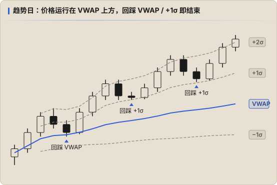
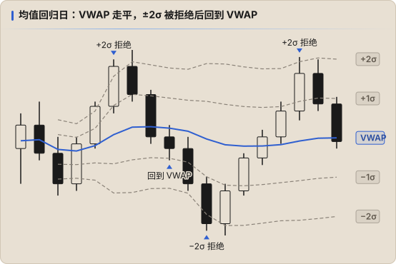

# VWAP 用法与 ICT 结合

## 基本读法

| 现象 | 含义 |
|---|---|
| 价格持续在 VWAP 上方，回踩 VWAP 被买起 | 多头控制，VWAP 是动态支撑 |
| 价格持续在 VWAP 下方，反弹到 VWAP 被卖下 | 空头控制，VWAP 是动态阻力 |
| 价格反复穿越 VWAP，VWAP 走平 | 平衡 / 震荡，没有一方控制 |
| VWAP 斜率明显 | 趋势日，平均成本在持续移动 |

## 两种日型

### 趋势日

- 价格在 VWAP 一侧运行，回撤到 **VWAP 或 ±1σ** 就结束
- 逆势在 ±2σ 摸顶摸底很危险，带会跟着价格走

### 均值回归日

- VWAP 走平，价格在 ±1σ ~ ±2σ 之间来回
- 触及 ±2σ 后拒绝，目标看回 VWAP

**怎么区分**：开盘后第一个小时 VWAP 的斜率、价格是否穿越过 VWAP。日型判断错误是 VWAP 交易最常见的亏损来源。

## 与 ICT 结合

VWAP 不替代 ICT 的核心条件，它补充的是 **「当前价格相对平均成本处于什么位置」**。

| 场景 | 组合方式 |
|---|---|
| **Premium / Discount** | Bias 看涨时，价格同时位于 dealing range 折价区 **且** 在 VWAP 下方（或回踩到 VWAP）= 双重折价，入场位置更优 |
| **PD Array 重叠** | FVG / OB 与 VWAP（或 ±1σ）重叠，汇合度更高 |
| **Judas Swing / 扫流动性** | 开盘扫掉对侧流动性时价格冲到 ±2σ 以外，随后收回带内并出现 MSS，是 Manipulation 的辅助证据 |
| **目标** | 逆势扫完流动性后，VWAP 常是第一目标（回到平均成本）；顺势时看对侧的 ±1σ / ±2σ 和 DOL |
| **AVWAP 锚定扫点** | 从扫掉流动性的那根 K 线锚定 AVWAP，价格守在它上方 / 下方说明这次扫点后的方向被接受 |

## 不该做的

- 只因为「价格离 VWAP 太远」就逆势
- 用 VWAP 推翻 HTF Bias 和 DOL
- 不同天混用 18:00 和 09:30 两种锚点去比较

## 记录方式

- 辅助确认时保持 `strategy: ICT`，在 `tags` 中标记，如 `tags: [vwap]`、`tags: [vwap-2sd-reject]`
- 复盘时写清锚点（session / RTH / AVWAP 锚定在哪根 K 线）
